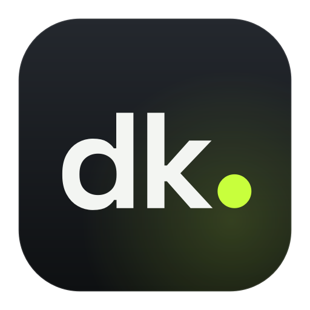

# don’t know what im doing



A personal desktop app that scans ~400 U.S. stocks during market hours, finds day-trade setups with simple
rule-based strategies, asks an AI for a second opinion, and places trades by itself **only when a separate set of
fixed safety rules says yes**. It starts in a demo simulator, then paper trading (fake money, real prices) at
Alpaca. Real-money trading stays locked until you explicitly authorize it.

> **Honest expectations.** This software can lose money. Nothing here shows that any strategy is profitable, and
> on a $100 account the regulatory fees and the bid/ask spread alone eat about 0.2% of every round trip. The app
> is built to *measure* whether a strategy has an edge after costs — and to refuse real money until there is
> evidence. It's not financial advice.

---

## 1. Install it (no terminal needed)

Download the file for your computer and open it:

* **Windows 10/11:** [dontknowwhatimdoing-windows-setup.exe](https://github.com/poireprojects/testing-out/releases/latest/download/dontknowwhatimdoing-windows-setup.exe)
  Double-click it. It installs for your user only (no admin needed), adds a Start menu entry and an optional
  desktop shortcut, then opens the app. If Windows SmartScreen says "unknown publisher", click
  **More info → Run anyway** (the app isn't code-signed; signing certificates cost money).
* **Mac (Apple Silicon):** [dontknowwhatimdoing-macos.dmg](https://github.com/poireprojects/testing-out/releases/latest/download/dontknowwhatimdoing-macos.dmg)
  Open it and drag the app into **Applications**. The first time only: **right-click the app → Open → Open**
  (it isn't notarized by Apple).

These links always point to the newest build (the **latest** release on GitHub). If the repository is private,
sign in to GitHub first.

When the app opens, a **guided setup** walks you through the rest:

1. **AI:** click **set it up for me**. The app downloads and installs the free Ollama AI runtime, starts it, and
   downloads a model sized to your computer's memory, with a progress bar. On Windows, Ollama's own installer
   window appears once; click through it. Prefer the cloud? Paste a Claude API key instead.
2. **Brokerage (optional):** buttons open Alpaca's free sign-up and the page where you create paper-trading keys;
   paste the two keys and click **connect**.
3. **Done:** switch to paper trading with one click, or stay in demo mode.

Closing the window keeps it running in the **system tray / menu bar**; use the tray icon → **quit** to exit.
Run the guided setup again any time from **settings → about & diagnostics**.

<details><summary>Prefer to build it yourself?</summary>

Install Python 3.12 from python.org, then double-click:

* Windows: `packaging\windows\BUILD-INSTALLER.bat` → installer appears in `dist\installer`.
* macOS: `packaging/macos/BUILD-APP.command` → `dist/dontknowwhatimdoing-macos.dmg`.
* Linux: `packaging/linux/build_linux.sh` → adds the app to your applications menu.
</details>

## Testing it over and over (works on Windows Home)

* **Fresh test copy:** the Start menu has **don’t know what im doing (fresh test)**. It's a separate copy of the app
  that erases itself every time you open it, so each launch is a brand-new first run: guided setup, no saved keys, no
  history. Your main copy is never touched. (Quit the main copy first, using the tray icon → quit. Only one copy runs
  at a time, so two copies never trade the same account.) On a Mac, run the app with `--profile test --fresh`.
* **Start over:** settings → **start over** erases the main copy's settings, trade history and saved keys, then
  reopens the guided setup. Your Alpaca account itself isn't changed.
* **Uninstall:** Windows Settings → Apps → *don’t know what im doing* → Uninstall. It works even while the app is
  hidden in the tray: the uninstaller asks the app to quit, waits until it has fully exited, and removes the program,
  shortcuts and launch-at-login entry. It then asks **"Keep your settings, trade history, logs and saved API keys?"**
  — **Yes** (the default) keeps them so a reinstall picks up where you left off; **No** deletes all of it, including
  the keys saved in Windows Credential Manager, for a completely fresh install. Nothing is deleted without that
  answer. If the app is holding **real-money** positions, the uninstall (and any update) refuses to run until you
  close them in the app, so live trades are never abandoned mid-way. Any safety check that can't run or fails
  (including a broken program folder) also stops the uninstall/update before anything is removed, and a copy that
  won't close is only force-closed after a fresh check shows no real-money positions and you agree — never during a
  silent install.

## 2. First launch: demo mode

You start in **demo mode**. A built-in simulator generates fake prices, so you can watch the scanner, the AI
activity log, trades and the reports actually work. An amber banner says *demo* everywhere, and demo results live in
their own database. They are never shown as real performance.

## 3. Doing it by hand instead

Everything the guided setup does is also in **settings**: brokerage keys under *brokerage — Alpaca*, and AI under
*ai* (local Ollama or a Claude key, model choice, monthly budget). If the AI is offline, times out or gives an
invalid answer, **no AI-dependent trade happens** — or switch *who decides entries* to **rules + ranker** (no AI).

---

## How it decides (in plain English)

1. **Scan.** Every ~60 s it pulls quick snapshots for ~400 liquid stocks and ETFs (two to five requests in total) and
   ranks them by unusual volume, intraday strength, liquidity and spread. The top 20 get minute-by-minute analysis
   every ~15 s.
2. **Spot a setup.** Five simple strategies look for: **intraday momentum**, **trend-following pullbacks**,
   **opening-range breakouts**, **VWAP reclaims** and **volume-confirmed breakouts**. Every indicator is computed
   only from bars that already happened (tested for look-ahead bias).
3. **Compare before spending.** Every setup found in the same moment is scored side by side: strength, reward vs.
   risk **after** spread, slippage and fees, how well the strategy suits today's market (*trending up*, *choppy*,
   *risk-off*, *volatile* — read from SPY, breadth and how hard the market is swinging), how many strategies agree,
   liquidity, and measured results from real history (never synthetic). Setups whose costs would eat the target,
   whose stop would have to be too wide, or that don't suit the market are passed over, and **not trading at all is
   a normal outcome** when nothing clears the bar. The AI Activity page shows every comparison and why each setup
   won or lost.
4. **Optional AI.** Settings → *who decides entries*: **rules + ranker** (no AI, no cost), **ai confirms** (each
   pick needs the AI's approval), or **ai picks** (the AI chooses one of the top three, or none). Answers must be
   strict JSON and are validated in code. An AI's confidence number is never treated as evidence of profit.
5. **Final say: the risk engine.** Deterministic rules the AI cannot override (defaults below). It can shrink a
   trade, tighten its stop, or block it, and says why in plain English.
6. **Execution.** A limit order slightly above the ask (avoids bad fills in fast markets), then a **broker-side stop
   order** so the position stays protected even if your computer turns off. Targets, trailing stops (to break-even
   after +1R, then trailing), time limits and strategy exits are handled by the app. **Everything is sold before the
   market closes.**

### Default safety rules (all adjustable in settings)

| Rule | Default |
|---|---|
| Starting capital | $100 |
| Max per position | $20 (scales with the account when reinvesting) |
| Positions at once | 2 |
| Daily loss limit | $2 — then no new trades until tomorrow |
| Max loss per trade if the stop hits | 1% of the account; sizes shrink to fit, and a stop-out can never be sized to break the daily limit |
| Stop distance | 0.4%–3%; setups that need wider stops are skipped |
| After 3 losses in a row | done for the day; each loss also shrinks the next trade by 25% |
| Always | no margin, no leverage, no shorting, no options, no crypto, no stale quotes (> 90 s), no wide spreads, DAY orders only |
| Emergency stop | big coral button: halts trading, cancels orders, sells every position the app opened |

Stop orders and loss limits **reduce** risk but cannot guarantee a maximum loss: prices can gap past a stop.

### Growing the account (compounding)

* **Reinvest** (default): limits follow your account. At $105 the max position becomes $21; at $95 it becomes $19.
* **Fixed allocation**: the app trades with a set amount and leaves profits alone.

Sizes use the **cash actually in the account** (capped by Alpaca's own buying-power figure), not the displayed
portfolio value, and they only ever shrink after losses. The app never borrows, even on accounts where Alpaca offers
2×–4× buying power. Risk is never increased to win money back.

### Is the AI actually helping?

Every candidate is followed as a *shadow trade* with identical exit rules, traded or not: all rules signals, the
ranker's picks, the AI's yeses and the AI's noes. **Performance → decision approaches compared** puts them side by
side after costs and says plainly whether the AI helps, adds nothing, costs more than it earns, or hurts — and,
until there are at least 30 of each, that it's still unproven. It also checks whether the AI's confidence has meant
anything (higher confidence → better outcomes?) and shows the AI cost per decision. AI decisions can't be
backtested honestly, so this comparison is made going forward.

---

## Brokerage facts this design is based on (checked November 2026)

* **The $25,000 pattern-day-trader rule is gone.** FINRA's Rule 4210 amendments took effect **June 4, 2026**, and
  Alpaca moved to an intraday-margin framework that day. A legacy guard is still in settings (off by default) in case
  a broker keeps enforcing day-trade counts.
* **Every Alpaca account is a margin account.** Under $2,000 of equity it's a *limited margin* account: 1× buying
  power (= cash), no borrowing, no shorting, but proceeds from a sale can buy again the **same day** — Alpaca covers
  the T+1 settlement float, so there are no good-faith violations. The app follows that by default (settings →
  *using money from today's sales* → **follow alpaca**) and is still capped by the cash in the account. **Settled
  only** remains available; it limits a $100 account to about five $20 round trips a day. (Sources: Alpaca docs
  "Account plans", "Margin and short selling", support "Can I have a cash account with Alpaca?".)
* **Fractional shares**: market, limit, stop and stop-limit orders, all **DAY only** (Alpaca docs, "Fractional
  trading"; verified against a real paper account). The app places a separate stop order after each buy. A stop only
  counts as protection once Alpaca has acknowledged it and it can still execute — an order that was sent without an
  answer, is being canceled, or was rejected, canceled or expired doesn't count.
* **Free market data is IEX-only.** Real-time prices come from one exchange (IEX, roughly 2–3% of U.S. volume), and
  full-market SIP data is 15 minutes delayed on the free plan. IEX prices track liquid stocks closely, but volumes are
  a small slice of the market and quotes are IEX's, not the national best bid/offer. The scanner says so, and volume is
  always compared with IEX's own history. The full SIP feed costs about $99/month, which isn't sensible for a $100
  account.
* ~200 data requests/minute on the free plan (the app throttles itself to 180).

## What happens when your laptop…

| Situation | What happens |
|---|---|
| **Is open & online** | Fully autonomous: starts scanning at 9:30 ET, trades, flattens before 4:00 ET, writes the daily summary. Optional "keep awake during market hours" prevents *idle* sleep. |
| **Window closed** | Keeps running in the tray/menu bar. |
| **Sleeps, lid closed, or shuts down** | **No trading happens.** Open positions keep their broker-side stop orders, but those expire at the close, so a position could be held overnight unprotected. When it wakes, the app notices the gap, throws away stale prices, re-syncs every order and position with Alpaca, and makes no new trade until a fresh scan has run. After a restart it reconciles first, then sells leftover positions after the next open (default). A banner warns when the laptop is on battery or "keep awake" is off while holding positions. |
| **Loses internet** | No new entries. Retries automatically. Broker-side stops still protect positions. On reconnect it reconciles every order and position. |
| **Alpaca is down** | Same as no internet. Unconfirmed orders are looked up by their unique ID before anything is retried, so duplicates aren't created. |
| **App crashes / restarts** | Orders are saved *before* they're sent, and everything is reconciled on startup. Tested: no duplicate orders or stops. |
| **Broker refuses a stop order, or never confirms it** (timeout, lost reply) | The app watches the stop price itself, shows a banner that the position isn't protected at the broker, looks the order up by its unique id (it is never written off until Alpaca confirms it doesn't exist, so no second sell order is stacked on top), and retries. In **live** mode no new real-money trade is opened while any position is unprotected, the position is **sold if no stop is confirmed within 10 minutes**, and two refusals in a day pause live entries until tomorrow. Leftover orders of the app that Alpaca still holds after a trade ended are canceled. |
| **Something goes wrong** | Settings → about & diagnostics → **save diagnostics file** puts a .zip with logs and a status summary on your desktop (never your API keys). Rejected orders are explained in plain English. |

Launch-at-login is in **settings → app behavior** (or choose it in the Windows installer).

## Monthly operating cost (estimate)

| Item | Cost |
|---|---|
| Alpaca paper trading, commissions | $0 |
| Market data (IEX) | $0 |
| Local AI (Ollama) | $0 (uses your computer) |
| Regulatory fees on sales (~$0.02 per sale on $20 trades) | ≈ $0.40–$4 depending on trade count |
| Optional cloud AI, ~10–20 decisions/day | Haiku 5.5 ≈ $0.15–0.30 · Sonnet 5.5 ≈ $2.50–5 · Opus 5.5 ≈ $5–11 (hard-capped by your budget) |
| **Typical total with local AI** | **≈ $1–4 / month**, nearly all regulatory fees |

The **performance → operating costs** card shows the real numbers as they happen.

## Going live (real money)

1. Paper-trade first. We suggest at least **20 trading days**.
2. Run a **backtest** (performance → strategy lab) on real Alpaca history. Only strategies marked **EVIDENCE ✓** can
   trade real money. Days are split in time order — first half to train, next quarter to validate, last quarter
   held out as an unseen test — and a strategy must pass **all** of: profitable after costs in all three periods,
   profit factor ≥ 1.15 on the test period, at least 30 test trades, beating random entries with the same stops and
   targets, an adjusted p-value below 0.10 (corrected for testing several strategies at once), profitable in at
   least 60% of walk-forward periods, still profitable with doubled slippage, and no collapse from training to
   testing (a sign of overfitting). The lab also replays the whole app with its 2-position limit and compares it
   with SPY buy-and-hold, SPY open-to-close and doing nothing. Missing history is reported and skipped, never filled
   in. Synthetic (demo) backtests can never count as evidence.
3. Add your **live** Alpaca keys (checked to be a live account), confirm the four statements, type
   `i authorize real-money trading`, then switch the mode to **live**.
4. Raising any risk limit later automatically pauses live trading until you re-authorize. Tightening limits doesn't.

---

## Testing

```
pip install -r requirements-dev.txt
python -m pytest -q
```

217 automated tests (215 run anywhere; 2 need your Alpaca paper keys) cover the uninstall/shutdown handshake
(open live positions block it; keep vs. delete data and saved keys), opportunity ranking and market regimes, the AI
picking mode, approach comparison and confidence calibration, walk-forward/train-validation-test evaluation, cost
stress, sleep/wake recovery, refused protective stops (retry + live block), plain-English rejections, the
diagnostics bundle (no secrets), market-data ingestion and batching, indicators (including look-ahead checks), every
strategy, AI response validation (malformed, out-of-range and missing fields → no trade), Ollama/Anthropic providers,
position sizing and compounding, settled cash (T+1 across weekends and holidays), fees, every risk rule, idempotent
order submission, duplicate prevention, lost responses, partial fills, network failures, crash/restart recovery,
external closes, protective-stop fallback, trailing stops, emergency stop, daily loss limit, end-of-day flatten, a
complete simulated trading day (P/L reconciled to the cent against the simulated broker's cash), paper/live
separation, the backtester's realism rules, and loading the real interface (`--self-test`).

### What is **not** verified yet

* **Real Alpaca calls.** The build environment couldn't reach Alpaca and had no keys. The adapters are tested
  against fakes that mirror alpaca-py's models. `tests/test_alpaca_integration.py` runs against your paper account
  when you set `ALPACA_PAPER_KEY` / `ALPACA_PAPER_SECRET`, and `ALPACA_PAPER_ORDER_TEST=1` adds a tiny
  far-from-market order that is cancelled immediately.
* **Whether Alpaca accepts fractional stop orders** for your account. If it doesn't, the fallback above kicks in.
* **Real historical backtests.** They need Alpaca keys. Only synthetic demo backtests have been run, and on that
  random data the evidence gate correctly found *no edge* in any strategy.
* **A real AI model.** Ollama and Claude responses are tested with recorded and fake responses. No real model was
  called, because Ollama isn't installed here and a cloud call would have cost money without your approval.
* **Native notifications and tray menus on your actual machine.** CI builds and self-tests the Windows installer
  and the macOS app, and every build runs a real install → launch (hidden in the tray) → uninstall → reinstall →
  clean uninstall → reinstall test on a Windows machine, including the live-position block. Visual behavior of the
  tray, notifications and the uninstall question dialog hasn't been observed by a person.
* **Profitability.** Unknown, and possibly negative. That's what paper trading and the evidence gate are for.

## Where things live

* Settings and data: `%LOCALAPPDATA%\dontknowwhatimdoing` (Windows) · `~/Library/Application Support/dontknowwhatimdoing` (macOS)
* Databases (one per mode: `trading_demo.db`, `trading_paper.db`, `trading_live.db`) and logs: open them from
  **settings → about & diagnostics**.
* Secrets: only in the OS credential store.

## Project layout

```
dkapp/
  scanner.py          two-stage market scanner
  strategies/         the five rule-based strategies
  analysis/           indicators + causal feature frame
  ai/                 prompts, providers (Ollama, Anthropic), validation, budget
  risk/               risk engine, sizing/compounding, fees, settlement ledger
  broker/             Alpaca adapter + simulated broker
  execution/          idempotent order manager
  engine/             trading engine (session state machine, reconciliation, recovery), shadow trades
  backtest/           bar-by-bar backtester, out-of-sample evidence gate
  data/               Alpaca + demo market data, universe, rate limiting
  ui/                 PySide6/QML interface, custom charts, tray, notifications
packaging/            PyInstaller spec, Windows installer, macOS/Linux build scripts
tests/                automated tests
```

Fonts: Space Grotesk and Inter, both under the SIL Open Font License (licenses in `dkapp/assets/fonts`).
For personal use only.
