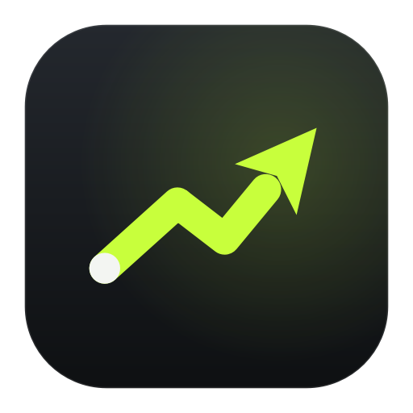

# StockPilot



A personal desktop app that scans ~400 U.S. stocks during market hours, finds day-trade setups with simple
rule-based strategies, asks an AI for a second opinion, and places trades by itself **only when a separate set of
fixed safety rules says yes**. It starts in a demo simulator, then paper trading (fake money, real prices) at
Alpaca. Real-money trading stays locked until you explicitly authorize it.

> **Honest expectations.** This software can lose money. Nothing here shows that any strategy is profitable, and
> on a $100 account the regulatory fees and the bid/ask spread alone eat about 0.2% of every round trip. The app
> is built to *measure* whether a strategy has an edge after costs — and to refuse real money until there is
> evidence. It's not financial advice.

> **Project status (2026-11-07).** No strategy has shown a profit after costs: 13 pre-registered hypotheses over
> four research phases.
> * **Phase 5** is building a separate autonomous AI trader (`autotrader/`). It runs only in simulation, is not
>   part of the desktop app, and cannot place orders.
> * Its forward test is **on hold** until a capable AI model passes a small, fixed-cost check. That check waits on
>   your approval (see *Research → Phase 5* below).
> * **Before leaving the app running:** in paper mode with **autopilot** on, it places *paper* orders with
>   strategies that have no evidence. Turn autopilot off to watch only. Details, and the API key you should rotate,
>   are in [`docs/OPERATIONAL-STATUS.md`](docs/OPERATIONAL-STATUS.md).
> * Pushes that change only research, tests or docs no longer publish a new installer.

---

## 1. Install it (no terminal needed)

Download the file for your computer and open it:

* **Windows 10/11:** [StockPilot-windows-setup.exe](https://github.com/poireprojects/testing-out/releases/latest/download/StockPilot-windows-setup.exe)
  Double-click it. It installs for your user only (no admin needed), adds a Start menu entry and an optional
  desktop shortcut, then opens the app. If Windows SmartScreen says "unknown publisher", click
  **More info → Run anyway** (the app isn't code-signed; signing certificates cost money).
* **Mac (Apple Silicon):** [StockPilot-macos.dmg](https://github.com/poireprojects/testing-out/releases/latest/download/StockPilot-macos.dmg)
  Open it and drag the app into **Applications**. The first time only: **right-click the app → Open → Open**
  (it isn't notarized by Apple).

**Already have an earlier version (from before the app was called StockPilot)?** Install this one over it; nothing
is lost. The Windows installer closes the earlier version only if its own safety check says it is safe (never with
open positions), then removes its program files and shortcuts. StockPilot carries over your settings, trade
history, saved keys and launch-at-login. On a Mac, drag StockPilot into Applications: the first time it opens, it
does the same and moves the earlier app to the Trash.

These links always point to the newest build (the **latest** release on GitHub). What changed in each version:
[CHANGELOG.md](CHANGELOG.md), also shown on every release. If the repository is private,
sign in to GitHub first.

When the app opens, a **guided setup** walks you through the rest:

1. **AI:** click **set it up for me**. The app downloads and installs the free Ollama AI runtime, starts it, and
   downloads a model sized to your computer's memory, with a progress bar. On Windows, Ollama's own installer
   window appears once; click through it. Prefer the cloud? Paste a Claude API key instead.
2. **Brokerage (optional):** buttons open Alpaca's free sign-up and the page where you create paper-trading keys;
   paste the two keys and click **connect**.
3. **Done:** switch to paper trading with one click, or stay in demo mode.

Closing the window keeps it running in the **system tray / menu bar**; use the tray icon → **quit** to exit.
Run the guided setup again any time from **settings → about & diagnostics**.

<details><summary>Prefer to build it yourself?</summary>

Install Python 3.12 from python.org, then double-click:

* Windows: `packaging\windows\BUILD-INSTALLER.bat` → installer appears in `dist\installer`.
* macOS: `packaging/macos/BUILD-APP.command` → `dist/StockPilot-macos.dmg`.
* Linux: `packaging/linux/build_linux.sh` → adds the app to your applications menu.
</details>

## Testing it over and over (works on Windows Home)

* **Fresh test copy:** the Start menu has **StockPilot (fresh test)**. It's a separate copy of the app
  that erases itself every time you open it, so each launch is a brand-new first run: guided setup, no saved keys, no
  history. Your main copy is never touched. (Quit the main copy first, using the tray icon → quit. Only one copy runs
  at a time, so two copies never trade the same account.) On a Mac, run the app with `--profile test --fresh`.
* **Start over:** settings → **start over** erases the main copy's settings, trade history and saved keys, then
  reopens the guided setup. Your Alpaca account itself isn't changed.
* **Uninstall:** Windows Settings → Apps → *StockPilot* → Uninstall. It works even while the app is
  hidden in the tray: the uninstaller asks the app to quit, waits until it has fully exited, and removes the program,
  shortcuts and launch-at-login entry. It then asks **"Keep your settings, trade history, logs and saved API keys?"**
  — **Yes** (the default) keeps them so a reinstall picks up where you left off; **No** deletes all of it, including
  the keys saved in Windows Credential Manager, for a completely fresh install. Nothing is deleted without that
  answer. If the app is holding **real-money** positions, the uninstall (and any update) refuses to run until you
  close them in the app, so live trades are never abandoned mid-way. Any safety check that can't run or fails
  (including a broken program folder) also stops the uninstall/update before anything is removed, and a copy that
  won't close is only force-closed after a fresh check shows no real-money positions and you agree — never during a
  silent install.

## 2. First launch: demo mode

You start in **demo mode**. A built-in simulator generates fake prices, so you can watch the scanner, the AI
activity log, trades and the reports actually work. An amber banner says *demo* everywhere, and demo results live in
their own database. They are never shown as real performance.

The window draws its own graphite title bar (app name, current page, market status, model stage, account mode,
and minimize / maximize / close) but behaves like any Windows window: drag it by empty title-bar space, double-click
to maximize, drag to a screen edge or press Win+arrow keys to snap, hover the maximize button for Windows 11 snap
layouts, and resize from any edge. Closing still goes to the tray (or asks first if positions are open).

## 3. Doing it by hand instead

Everything the guided setup does is also in **settings**: brokerage keys under *brokerage — Alpaca*, and AI under
*ai* (local Ollama or a Claude key, model choice, monthly budget). If the AI is offline, times out or gives an
invalid answer, **no AI-dependent trade happens** — or switch *who decides entries* to **rules + ranker** (no AI).

---

## How it decides (in plain English)

1. **Scan.** Every ~60 s it pulls quick snapshots for ~400 liquid stocks and ETFs (two to five requests in total) and
   ranks them by unusual volume, intraday strength, liquidity and spread. The top 20 get minute-by-minute analysis
   every ~15 s.
2. **Spot a setup.** Five simple strategies look for: **intraday momentum**, **trend-following pullbacks**,
   **opening-range breakouts**, **VWAP reclaims** and **volume-confirmed breakouts**. Every indicator is computed
   only from bars that already happened (tested for look-ahead bias).
3. **Compare before spending.** Every setup found in the same moment is scored side by side: strength, reward vs.
   risk **after** spread, slippage and fees, how well the strategy suits today's market (*trending up*, *choppy*,
   *risk-off*, *volatile* — read from SPY, breadth and how hard the market is swinging), how many strategies agree,
   liquidity, and measured results from real history (never synthetic). Setups whose costs would eat the target,
   whose stop would have to be too wide, or that don't suit the market are passed over, and **not trading at all is
   a normal outcome** when nothing clears the bar. The AI Activity page shows every comparison and why each setup
   won or lost.
4. **Statistical model (shadow).** A small, calibrated model (`stockpilot/quant`) estimates every candidate's chance of
   making money and its expected result after costs, with an uncertainty band, from the same point-in-time
   features used in research. It ships at **shadow** stage: it shows its estimate on every setup (AI Activity) and
   never changes a trade. It could only ever *block* paper trades, and only if a pre-registered test said it
   adds value — it didn't (see *Research* below). Models are versioned with a fingerprint and can be rolled back.
5. **Optional language model.** Settings → *who decides entries*: **rules + ranker** (default; no AI, no cost),
   **ai confirms**, or **ai picks**. The app hands the model the numbers it computed (stop and target distance,
   reward/risk after costs, RSI and what its level means) and **rejects any answer whose explanation contradicts
   them**. In testing, the local 3B model approved 72 of 72 picks and added nothing, so in **live** mode a language
   model never authorizes a trade; in paper the AI modes remain available as experiments.
6. **Final say: the risk engine.** Deterministic rules the AI cannot override (defaults below). It can shrink a
   trade, tighten its stop, or block it, and says why in plain English.
7. **Execution.** A limit order slightly above the ask (avoids bad fills in fast markets), then a **broker-side stop
   order** so the position stays protected even if your computer turns off. Targets, trailing stops (to break-even
   after +1R, then trailing), time limits and strategy exits are handled by the app. **Everything is sold before the
   market closes.**

### Default safety rules (all adjustable in settings)

| Rule | Default |
|---|---|
| Starting capital | $100 |
| Max per position | $20 (scales with the account when reinvesting) |
| Positions at once | 2 |
| Daily loss limit | $2 — then no new trades until tomorrow |
| Max loss per trade if the stop hits | 1% of the account; sizes shrink to fit, and a stop-out can never be sized to break the daily limit |
| Stop distance | 0.4%–3%; setups that need wider stops are skipped |
| After 3 losses in a row | done for the day; each loss also shrinks the next trade by 25% |
| Always | no margin, no leverage, no shorting, no options, no crypto, no stale quotes (> 90 s), no wide spreads, DAY orders only |
| Emergency stop | big coral button: halts trading, cancels orders, sells every position the app opened |

Stop orders and loss limits **reduce** risk but cannot guarantee a maximum loss: prices can gap past a stop.

### Growing the account (compounding)

* **Reinvest** (default): limits follow the app's **own** results — the starting capital plus what it has made
  or lost. At $105 the max position becomes $21; at $95 it becomes $19. Other money in the account (a paper
  account's $100,000, a bigger deposit) is never used unless you raise the starting capital in settings.
* **Fixed allocation**: the app trades with a set amount and leaves profits alone.

Sizes use the **cash actually in the account** (capped by Alpaca's own buying-power figure), not the displayed
portfolio value, and they only ever shrink after losses. The app never borrows, even on accounts where Alpaca offers
2×–4× buying power. Risk is never increased to win money back.

### Research: is there an edge? (November 2026)

No — not yet. Round 1 (`research/runs/2026-11-06-round1/REPORT.md`), in short:

* One year of real 1-minute history (40 symbols). Hypotheses and pass/fail rules were **committed before** any
  result was computed, and a reserved holdout (81 days) was evaluated **once**.
* On that unseen holdout, every approach that trades lost money after costs: the app's rules + ranker −0.13% per
  trade (−$6.11 on $100 over 81 days), intraday mean reversion −0.15%, relative strength −0.13%, market intraday
  momentum −0.27%. The statistical models declined every trade. Doing nothing was best.
* Why: a $20 round trip costs ≈0.17% (spread + slippage, plus Alpaca rounding each day's fees up to a cent); the
  strongest signal measured is worth ≈0.04% over 30 minutes. More capital doesn't fix that — the cost is a percentage.

**Phase 2** (`research/runs/2026-11-07-phase2/REPORT.md`) tested five new, pre-registered ideas:

* holding to the close
* gap "stocks in play" breakouts
* passive limit entries
* index ETFs overnight (research only)
* a multi-day SPY trend filter (research only)

They were tested on a second untouched holdout: two years, 2023-09 → 2025-08, used once.

* No strategy passed. On the holdout, per trade:

  | idea | result |
  |---|---:|
  | momentum held to the close | −0.19% |
  | gap stocks | −0.18% |
  | passive entries | −0.16% |
  | overnight ETFs (per night) | −0.08% |

* The trend filter returned +33% against buy-and-hold's +43%, with less than half the drawdown. After testing five
  ideas, it can't be told apart from luck. It is also multi-day, which the app does not do.
* What we learned:
  * The app's signals have no direction (≈0% before costs).
  * Gap stocks move a lot but reverse as often as they continue.
  * Passive limit orders save half the cost but fill mostly on the trades that go on to lose.
* Every day of history used so far is recorded in `research/ledger.json`. The only untouched history left (2020-07 →
  2022-10) is reserved for one future test.

**Phase 3** (`research/runs/2026-11-07-phase3/REPORT.md`) tried holding for days and weeks instead of minutes:

* industry relative strength (hold the 3 strongest of 12 industries, monthly)
* the turn-of-the-month effect (hold the market around each month-end)

It used 80 years of survivorship-free academic data (Ken French) and an untouched 2006–2020 holdout.

* Holding longer fixes the cost problem: monthly rebalancing costs under 2% a year, against about 35% for daily
  trading.
* Neither rule kept an edge:
  * The turn of the month earned +0.52% per window in 1926–2005, then +0.04% (p = 0.40) in 2006–2020.
  * Industry strength beat equal weight by only +0.13% a month, too little after correcting for the ideas
    tried.
* A small model that tried to pick the good months added nothing (AUC 0.52).
* The last untouched history (2020-07 → 2022-10) was **not** used, because no candidate earned it.
* The only reliably positive return in the data is owning the market itself, about 9% a year with 55–84%
  drawdowns. That is investing, not an edge.

**Phase 4** (`research/runs/2026-11-07-phase4/REPORT.md`) asked whether time-stamped company news (SEC 8-K filings,
earnings releases) gives an intraday edge that price-only rules lack.

* Data audit of 50 disclosures:
  * SEC acceptance times are exact, but often later than the first public release (by over an hour for 7.6% of
    earnings releases).
  * Release times can be verified only for earnings, and those come out before the open or after the close.
  * The free IEX feed shows neither the real price nor the real spread.
* The one testable rule was frozen before testing: buy at 10:00 after an earnings beat on both EPS and sales,
  if the stock is outperforming its sector.
  * It lost **−0.27% per trade** after measured costs (974 trades, 2024-11 → 2026-10).
  * It did no better than a price-only look-alike, so the news added nothing.
  * A later audit found the test charged fees per trade instead of per day. Corrected, it still lost −0.19% per
    trade (`research/runs/2026-11-07-phase4/corrected/`). The original results are kept unchanged.
* **Decision: NO-GO.** No app changes.

* New evidence now comes from **forward** observation:
  * The app records every eligible setup, taken or not, at the moment it sees it, in an append-only,
    hash-chained table. It scores each one after the close against prices that came later.
  * Multi-day rules (sector strength, turn of the month and an SPY benchmark) are recorded in **shadow only**:
    * Each decision is made from that day's adjusted closes inside its own window.
    * It is never backfilled; a window the app wasn't running for is counted as missed.
    * It is scored after the holding ends.
    * No orders, nothing held overnight.
  * See Performance → *forward evidence*, or run `python scripts/forward_report.py`.
* Nothing is promoted without:
  * ≥100 forward trades over ≥30 days
  * a multiple-testing-adjusted p < 0.05 after costs
  * your explicit approval

**Strategic reset** (`research/runs/2026-11-07-reset/REPORT.md`) asked where trading profits actually come from.
* Reliable trading profits go to market makers and a few large firms. They earn them from spreads, order flow,
  speed and scale, none of which a retail account has.
* What an individual *can* reproduce are risk premia (owning the market, trend-following, merger arbitrage). Those
  pay roughly market-like returns, with long drawdowns.
* **More capital would not have rescued any failed strategy.** Their edge before costs was smaller than the spread,
  and the spread is a percentage of every trade.
* $1,000 a month at realistic returns needs roughly $120,000–$300,000.
* What would justify reopening this research: `research/REOPENING-CRITERIA.md`.

**Phase 5** (`research/PHASE5-AUTONOMOUS.md`) is a prototype of an AI that trades on its own, without asking you
about each trade. It runs **only in simulation**.
* **How it works:**
  * It reads new SEC filings and the company's financial history.
  * It writes a thesis: facts that must cite their source sentences, interpretation, uncertainty, what the market
    has already priced in, and what would prove it wrong.
  * It decides to trade or not.
  * The app's own risk engine checks every proposal (the $100 / $20 / 2-position / $2-a-day limits, which the AI
    cannot change).
  * The trade is simulated with realistic costs.
  * Everything is recorded in a tamper-evident ledger, and a daily report is written.
  * Any invalid answer, invented figure or failure becomes "no trade".
* **What we found:** the free local model (Llama 3.2 3B) is not good enough.
  * Only 8 of 30 answers passed the source checks; after a stricter answer format, 2 of 30.
  * Its probabilities were worse than a constant guess.
  * It proposed no trades.
  * Every invented figure was caught.
* **Corrected since the first version:**
  * Predictions are scored on the session they target (a Saturday decision is scored on Monday).
  * Finished sessions are scored automatically once prices exist, against simple rules computed only from data
    available at 10:00.
* **Next steps, each needing your decision:**
  * a fixed-cost check of a capable model: Claude Opus 5.5 on 160 past events, hard ceiling $12.50, expected $5–7
    (`research/runs/2026-11-07-phase5/dev-eval/PLAN.md`);
  * a new market-data key, to score forward decisions;
  * a computer that stays on, to run it.
* No real orders, no paid calls and no new installer so far. Sophisticated reasoning is not a demonstrated edge.

### Is the AI actually helping?

Every candidate is followed as a *shadow trade* with identical exit rules, traded or not: all rules signals, the
ranker's picks, the AI's yeses and the AI's noes. **Performance → decision approaches compared** puts them side by
side after costs and says plainly whether the AI helps, adds nothing, costs more than it earns, or hurts — and,
until there are at least 30 of each, that it's still unproven. It also checks whether the AI's confidence has meant
anything (higher confidence → better outcomes?) and shows the AI cost per decision. AI decisions can't be
backtested honestly, so this comparison is made going forward.

---

## Brokerage facts this design is based on (checked November 2026)

* **The $25,000 pattern-day-trader rule is gone.** FINRA's Rule 4210 amendments took effect **June 4, 2026**, and
  Alpaca moved to an intraday-margin framework that day. A legacy guard is still in settings (off by default) in case
  a broker keeps enforcing day-trade counts. (The later strategic reset could not independently confirm the final
  rule, so check with Alpaca before relying on it.)
* **Every Alpaca account is a margin account.** Under $2,000 of equity it's a *limited margin* account: 1× buying
  power (= cash), no borrowing, no shorting, but proceeds from a sale can buy again the **same day** — Alpaca covers
  the T+1 settlement float, so there are no good-faith violations. The app follows that by default (settings →
  *using money from today's sales* → **follow alpaca**) and is still capped by the cash in the account. **Settled
  only** remains available; it limits a $100 account to about five $20 round trips a day. (Sources: Alpaca docs
  "Account plans", "Margin and short selling", support "Can I have a cash account with Alpaca?".)
* **Fractional shares**: market, limit, stop and stop-limit orders, all **DAY only** (Alpaca docs, "Fractional
  trading"; verified against a real paper account). The app places a separate stop order after each buy. A stop only
  counts as protection once Alpaca has acknowledged it and it can still execute — an order that was sent without an
  answer, is being canceled, or was rejected, canceled or expired doesn't count.
* **Free market data is IEX-only.** Real-time prices come from one exchange (IEX, roughly 2–3% of U.S. volume), and
  full-market SIP data is 15 minutes delayed on the free plan. IEX prices track liquid stocks closely, but volumes are
  a small slice of the market and quotes are IEX's, not the national best bid/offer. The scanner says so, and volume is
  always compared with IEX's own history. The full SIP feed costs about $99/month, which isn't sensible for a $100
  account.
* ~200 data requests/minute on the free plan (the app throttles itself to 180).
* **Fees (checked 2026-11-06 against Alpaca's brokerage fee schedule and FINRA notices):** no commission; SEC fee
  $20.60 per $1M sold (since 2026-04-04); FINRA TAF **$0** for Oct–Dec 2026, back to $0.000195/share sold on
  2027-01-01; FINRA CAT $0.000003/share bought or sold. Alpaca adds up each fee type per **day** and rounds that
  total up to a cent — on $20 trades that's about $0.02–0.03 a day, not per trade. (Build 20 assumed $0.02 per sale.)

## What happens when your laptop…

| Situation | What happens |
|---|---|
| **Is open & online** | Fully autonomous: starts scanning at 9:30 ET, trades, flattens before 4:00 ET, writes the daily summary. Optional "keep awake during market hours" prevents *idle* sleep. |
| **Window closed** | Keeps running in the tray/menu bar. |
| **Sleeps, lid closed, or shuts down** | **No trading happens.** Open positions keep their broker-side stop orders, but those expire at the close, so a position could be held overnight unprotected. When it wakes, the app notices the gap, throws away stale prices, re-syncs every order and position with Alpaca, and makes no new trade until a fresh scan has run. After a restart it reconciles first, then sells leftover positions after the next open (default). A banner warns when the laptop is on battery or "keep awake" is off while holding positions. |
| **Loses internet** | No new entries. Retries automatically. Broker-side stops still protect positions. On reconnect it reconciles every order and position. |
| **Alpaca is down** | Same as no internet. Unconfirmed orders are looked up by their unique ID before anything is retried, so duplicates aren't created. |
| **App crashes / restarts** | Orders are saved *before* they're sent, and everything is reconciled on startup. Tested: no duplicate orders or stops. |
| **Broker refuses a stop order, or never confirms it** (timeout, lost reply) | The app watches the stop price itself, shows a banner that the position isn't protected at the broker, looks the order up by its unique id (it is never written off until Alpaca confirms it doesn't exist, so no second sell order is stacked on top), and retries. In **live** mode no new real-money trade is opened while any position is unprotected, the position is **sold if no stop is confirmed within 10 minutes**, and two refusals in a day pause live entries until tomorrow. Leftover orders of the app that Alpaca still holds after a trade ended are canceled. |
| **Holds a position after the close** (app off at the close, or a sale didn't go through) | Fractional-share stops are day orders, so **nothing at the broker protects it overnight** and a gap at the next open can't be prevented. The app says so (notification + activity log) as soon as it sees it, places a new stop at the open and sells after the opening minutes (default). This can't be prevented while the laptop is off. |
| **Something goes wrong** | Settings → about & diagnostics → **save diagnostics file** puts a .zip with logs and a status summary on your desktop (never your API keys). Rejected orders are explained in plain English. |

Launch-at-login is in **settings → app behavior** (or choose it in the Windows installer).

## Monthly operating cost (estimate)

| Item | Cost |
|---|---|
| Alpaca paper trading, commissions | $0 |
| Market data (IEX) | $0 |
| Local AI (Ollama) | $0 (uses your computer) |
| Regulatory fees (SEC + TAF + CAT, rounded once a day per fee type) | ≈ $0.40–$0.65 |
| Optional cloud AI, ~10–20 decisions/day | Haiku 5.5 ≈ $0.15–0.30 · Sonnet 5.5 ≈ $2.50–5 · Opus 5.5 ≈ $5–11 (hard-capped by your budget) |
| **Typical total with local AI** | **≈ $0.50 / month** — spread and slippage (≈0.13% per round trip) cost far more than any fee |

The **performance → operating costs** card shows the real numbers as they happen.

## Going live (real money)

1. Paper-trade first. We suggest at least **20 trading days**.
2. Run a **backtest** (performance → strategy lab) on real Alpaca history. Only strategies marked **EVIDENCE ✓** can
   trade real money. Days are split in time order — first half to train, next quarter to validate, last quarter
   held out as an unseen test — and a strategy must pass **all** of: profitable after costs in all three periods,
   profit factor ≥ 1.15 on the test period, at least 30 test trades, beating random entries with the same stops and
   targets, an adjusted p-value below 0.10 (corrected for testing several strategies at once), profitable in at
   least 60% of walk-forward periods, still profitable with doubled slippage, and no collapse from training to
   testing (a sign of overfitting). The lab also replays the whole app with its 2-position limit and compares it
   with SPY buy-and-hold, SPY open-to-close and doing nothing. Missing history is reported and skipped, never filled
   in. Synthetic (demo) backtests can never count as evidence.
3. Add your **live** Alpaca keys (checked to be a live account), confirm the four statements, type
   `i authorize real-money trading`, then switch the mode to **live**.
4. Raising any risk limit later automatically pauses live trading until you re-authorize. Tightening limits doesn't.

---

## Testing

```
pip install -r requirements-dev.txt
python -m pytest -q
```

503 automated tests. 495 run anywhere; 8 need your Alpaca paper keys, and 4 of those place paper orders, so they
run only when you ask. They cover the uninstall/shutdown handshake
(open live positions block it; keep vs. delete data and saved keys), opportunity ranking and market regimes, the AI
picking mode, approach comparison and confidence calibration, walk-forward/train-validation-test evaluation, cost
stress, sleep/wake recovery, refused protective stops (retry + live block), plain-English rejections, the
diagnostics bundle (no secrets), market-data ingestion and batching, indicators (including look-ahead checks), every
strategy, AI response validation (malformed, out-of-range and missing fields → no trade), Ollama/Anthropic providers,
position sizing and compounding, settled cash (T+1 across weekends and holidays), fees, every risk rule, idempotent
order submission, duplicate prevention, lost responses, partial fills, network failures, crash/restart recovery,
external closes, protective-stop fallback, trailing stops, emergency stop, daily loss limit, end-of-day flatten, a
complete simulated trading day (P/L reconciled to the cent against the simulated broker's cash), paper/live
separation, the backtester's realism rules, and loading the real interface (`--self-test`).

They also cover the research tooling:
* the phase-4 integrity corrections;
* the release gate that keeps research-only pushes from publishing installers;
* the Phase 5 prototype: evidence time stamps and look-ahead guards, tamper and duplicate detection, rejection of
  invented or ungrounded answers, every risk rejection, safe failure when the model, data or ledger fails,
  target-session scoring, unattended forward scoring, and the paid-model spending ceiling (with fake clients; no
  paid call).

### What is verified and what isn't

* **Verified:** real Alpaca paper calls (8 integration tests: account, assets, fractional limit orders, a
  fractional buy with a broker DAY stop, a raised stop and a safe exit, the engine's own order paths; account left
  clean); real historical backtests with a frozen, reproducible baseline (`research/baselines/build20`); a real local
  language model (Llama 3.2 3B) on recorded decisions; the Windows installer, upgrade-over-a-running-copy and
  every blocked-uninstall scenario on a real Windows CI machine; the window frame's hit-testing, maximize bounds,
  restore and minimize via `--chrome-selftest` at 100/125/150% on Windows CI; the Phase 5 prototype end to end
  with a real local model, real SEC filings and cached market data.
* **Not verified by a person:** the Windows 11 **Snap Layouts flyout** itself (CI checks the documented
  requirement — the maximize button answers `HTMAXBUTTON` — but the flyout only appears for a real mouse on
  Windows 11), multi-monitor dragging between screens with different scaling, the tray, notifications and the
  uninstall question dialogs.
* **Profitability:** not demonstrated — see *Research* above.

## Where things live

* Settings and data: `%LOCALAPPDATA%\StockPilot` (Windows) · `~/Library/Application Support/StockPilot` (macOS)
* Databases (one per mode: `trading_demo.db`, `trading_paper.db`, `trading_live.db`) and logs: open them from
  **settings → about & diagnostics**.
* Secrets: only in the OS credential store.

## Project layout

```
stockpilot/
  scanner.py          two-stage market scanner
  strategies/         the five rule-based strategies
  analysis/           indicators + causal feature frame
  ai/                 prompts, providers (Ollama, Anthropic), validation, budget
  risk/               risk engine, sizing/compounding, fees, settlement ledger
  broker/             Alpaca adapter + simulated broker
  execution/          idempotent order manager
  engine/             trading engine (session state machine, reconciliation, recovery), shadow trades
  backtest/           bar-by-bar backtester, out-of-sample evidence gate
  data/               Alpaca + demo market data, universe, rate limiting
  ui/                 PySide6/QML interface, custom charts, tray, notifications
  research/           forward recorders used by the app, plus research-only modules
autotrader/           Phase 5 autonomous-trader prototype (simulation only; not in the app or installer)
packaging/            PyInstaller spec, Windows installer, macOS/Linux build scripts, release gate
research/             pre-registrations, data ledger, reports and results of every research phase
scripts/              research and data scripts (historical data only)
docs/                 operational status and published results
tests/                automated tests
```

Fonts: Space Grotesk and Inter, both under the SIL Open Font License (licenses in `stockpilot/assets/fonts`).
For personal use only.
