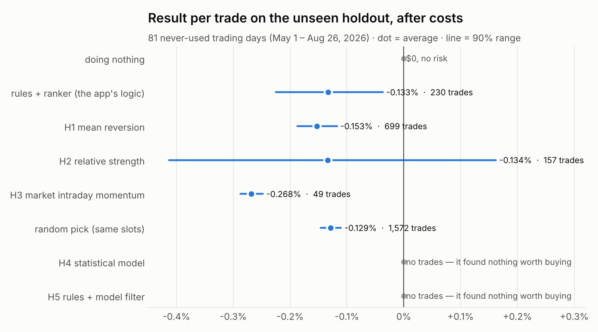
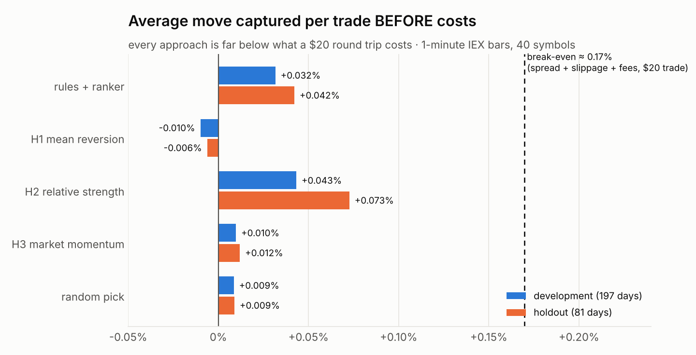
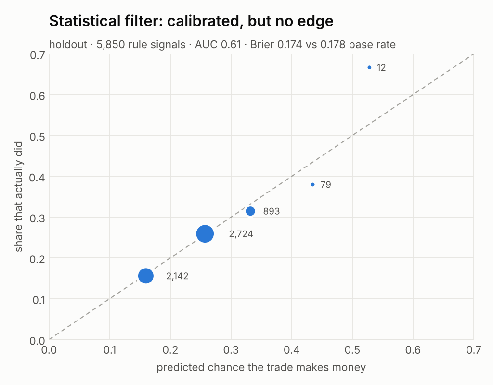

# Research round 1 — can better trade selection beat costs?

Pre-registered in `research/PREREGISTRATION-2026-11-06.md` (committed before any result). Development = walk-forward over 197 days (2025-09-16 → 2026-04-30 and the already examined 2026-09-11 → 2026-11-05). **Holdout = 81 days (2026-05-01 → 2026-08-26), registered before download and evaluated once** (`research/HOLDOUT_USED.json`). 40 symbols, Alpaca IEX 1-minute bars, 3240/3240 holdout symbol-days and 7880/7880 development symbol-days present.

## Answer

* **No positive-expected-value strategy was found.** Every approach that trades loses money after costs on the unseen holdout; doing nothing was best.
* **The statistical models did not beat the rules on profit** — they did better only by declining every trade. Their win probabilities are calibrated and slightly informative, but they cannot predict the *size* of results, so no candidate ever showed a positive expected result after costs.
* **The 3B language model adds no measurable value**: it approved 72 of 72 picks and ~14% of its explanations contradicted the app's own numbers.
* **Why:** a $20 round trip costs ≈0.17%; the best measured signal is worth ≈0.04% over 30 minutes.

## Results (after costs, $100 account, 2 slots of $20)

| approach | dev trades | dev net/trade | dev 90% range | holdout trades | holdout net/trade | holdout 90% range | holdout $ | verdict |
|---|---|---|---|---|---|---|---|---|
| rules + ranker (the app's logic) | 434 | -0.136% | -0.191% … -0.080% | 230 | -0.133% | -0.225% … -0.037% | -6.11 | baseline |
| H1 mean reversion | 1,477 | -0.154% | -0.174% … -0.132% | 699 | -0.153% | -0.188% … -0.117% | -21.40 | rejected |
| H2 relative strength | 379 | -0.142% | -0.285% … +0.002% | 157 | -0.134% | -0.413% … +0.162% | -4.20 | rejected |
| H3 market intraday momentum | 108 | -0.229% | -0.249% … -0.209% | 49 | -0.268% | -0.287% … -0.248% | -2.63 | insufficient |
| random pick (same slots) | 3,785 | -0.127% | -0.138% … -0.116% | 1,572 | -0.129% | -0.146% … -0.110% | -40.50 | baseline |
| H4 statistical model | 21 | -0.071% | -0.377% … +0.271% | 0 | +0.000% | +0.000% … +0.000% | +0.00 | insufficient |
| H5 rules + model filter | 4 | -0.519% | -1.417% … +0.491% | 0 | +0.000% | +0.000% … +0.000% | +0.00 | insufficient |
| doing nothing | 0 | 0 | — | 0 | 0 | — | 0.00 | baseline |

Percentages are per trade (P/L ÷ the $20 position), not of the account. Holm–Bonferroni across H1–H5: every adjusted p = 1.00. "insufficient" = fewer than 100 trades.

### Why each was rejected (holdout)

* **H2** — rejected: loses -0.134% per trade after costs; could be luck after testing several ideas (Holm-adjusted p=1.00); profitable in only 2 of 4 periods; negative if slippage doubles; not better than the best simple baseline (+0.000% per trade)
* **H1** — rejected: loses -0.153% per trade after costs; could be luck after testing several ideas (Holm-adjusted p=1.00); profitable in only 0 of 4 periods; negative if slippage doubles; not better than the best simple baseline (+0.000% per trade)
* **H3** — insufficient: only 49 trades (need 100); loses -0.268% per trade after costs; could be luck after testing several ideas (Holm-adjusted p=1.00); profitable in only 0 of 4 periods; negative if slippage doubles; not better than the best simple baseline (+0.000% per trade)
* **H4** — insufficient: only 0 trades (need 100); loses +0.000% per trade after costs; could be luck after testing several ideas (Holm-adjusted p=1.00); negative if slippage doubles; not better than the best simple baseline (+0.000% per trade)
* **H5** — insufficient: only 0 trades (need 100); loses +0.000% per trade after costs; could be luck after testing several ideas (Holm-adjusted p=1.00); negative if slippage doubles; not better than the best simple baseline (+0.000% per trade)

## The statistical models

| model | holdout rows | base rate | Brier | Brier of base rate | AUC (win/lose) | AUC of expected result | calibration error |
|---|---|---|---|---|---|---|---|
| H4 dense (every symbol, every 30 min) | 34,905 | 29.6% | 0.2070 | 0.2085 | 0.563 | 0.498 | 0.0083 |
| H5 filter on the rules' signals | 5,850 | 23.2% | 0.1735 | 0.1784 | 0.612 | 0.487 | 0.0060 |

L2-regularised logistic + ridge regression (numpy), 15 point-in-time features (+9 strategy features for H5), standardised on training days only, expanding walk-forward with a 1-day embargo. The H5 model ships with the app at **shadow** stage (`dkapp/assets/models/strategy-filter-v1.json`): it shows its estimate for every candidate and never changes a trade.

## Why the original strategies lose (development, 197 days)

| strategy | signals | before costs | after costs | 30-min move vs average (90% range) | best/worst excursion | gave back a move > cost |
|---|---|---|---|---|---|---|
| momentum | 1,380 | +0.012% | -0.118% | +0.041% (-0.010% … +0.086%) | +0.40% / -0.28% | 22% |
| trend | 3,642 | -0.002% | -0.133% | +0.021% (-0.010% … +0.053%) | +0.45% / -0.30% | 29% |
| orb | 1,497 | -0.015% | -0.146% | +0.009% (-0.021% … +0.039%) | +0.47% / -0.36% | 26% |
| vwap | 5,698 | -0.015% | -0.146% | -0.002% (-0.017% … +0.013%) | +0.25% / -0.17% | 18% |
| volume_breakout | 1,755 | +0.012% | -0.119% | +0.035% (+0.007% … +0.064%) | +0.26% / -0.17% | 11% |

* **Signal information is real but tiny.** Momentum and volume-breakout entries drift +0.03–0.04% more than an average entry over 30 minutes; trend, opening-range and VWAP entries ≈0.
* **Moves are too small for the costs.** The median 30-minute move is 0.20% in either direction; break-even is 0.17%.
* **Exits:** the strategies' own exit rules close most trades at a small loss before costs; only the rare targets (≈5–10%) make +1.3%. 11–29% of trades were ahead by more than the cost at some point and still lost.
* **Regime matters, but only after the fact:** up-and-volatile days averaged +0.106% before costs, down-and-volatile -0.097%. Nothing here predicts the day in advance.
* **The ranker does select better than chance** (+0.032% vs -0.015% random before costs) — not by enough.

## Language model (Llama 3.2 3B, local)

* 72 recorded answers: approved 72, average confidence 0.95, median 43 s per answer.
* 10 (14%) explanations contradicted numbers the app computed (invented stop distances, RSI called "oversold" at 64, prices written as percentages). From this build such answers are rejected, and the model is given the computed numbers as facts.
* Rules + ranker vs rules + LLM confirmation: identical trades and results (build 20 replay). It fails two pre-registered checks (latency > 30 s, ≥ 5% inconsistent), so it gets **no trade authority with real money**; the default decision mode is now rules + ranker.
* A stronger local model was not downloaded: on a 4-core laptop a 7–8B model takes ~2–3× longer per answer, which makes intraday signals stale before it replies.

## Economics

| position | spread | slippage | SEC | TAF | CAT | fee rounding | total round trip |
|---|---|---|---|---|---|---|---|
| $20 | 0.030% | 0.100% | 0.0021% | 0.0002% | 0.00001% | 0.0375% | **0.170%** |
| $100 | 0.030% | 0.100% | 0.0021% | 0.0002% | 0.00001% | 0.0075% | **0.140%** |
| $200 | 0.030% | 0.100% | 0.0021% | 0.0002% | 0.00001% | 0.0037% | **0.136%** |
| $1,000 | 0.030% | 0.100% | 0.0021% | 0.0002% | 0.00001% | 0.0008% | **0.133%** |
| $2,000 | 0.030% | 0.100% | 0.0021% | 0.0002% | 0.00001% | 0.0004% | **0.133%** |

Spread (3 bps) and slippage (5 bps per side) are modeled assumptions; fees are from the broker's current schedule (rounded once per fee type per day). Bigger positions only dilute the fixed fee rounding — the 0.13% of spread + slippage stays, so more capital does not fix a missing edge.

Hypothetical month (21 days, 4 trades/day, $20-of-$100 sizing scaled to capital) — arithmetic, not a forecast:

| capital | −0.10%/trade | 0% | +0.05%/trade | +0.10%/trade | 90% range at +0.05% |
|---|---|---|---|---|---|
| $100 | -1.68 | +0.00 | +0.84 (+0.84% of account) | +1.68 | -1.77 … +3.45 |
| $500 | -8.40 | +0.00 | +4.20 (+0.84% of account) | +8.40 | -8.84 … +17.24 |
| $1,000 | -16.80 | +0.00 | +8.40 (+0.84% of account) | +16.80 | -17.68 … +34.48 |
| $5,000 | -84.00 | +0.00 | +42.00 (+0.84% of account) | +84.00 | -88.42 … +172.42 |
| $10,000 | -168.00 | +0.00 | +84.00 (+0.84% of account) | +168.00 | -176.84 … +344.84 |

Capital needed for $100/month at +0.05% net per trade and 4 trades/day: **$11,905**; at +0.10%: $5,952. A $99/month data plan would need ≈$11,786 of capital at +0.05% just to pay for itself. None of these edges exists today; they show the scale required if one is found.

## What would count as progress next

1. **Forward shadow evidence** (starts automatically from 2026-11-09): the app records the rules, ranker and model estimate for every candidate; nothing is promoted without ≥ 100 forward trades over ≥ 30 days, positive after costs with a multiple-testing-adjusted p < 0.05, and your approval.
2. **Cut costs, not just pick better:** the measured signal is ≈¼ of the cost. Realistic routes are lower turnover (fewer, longer holds) or verified cheaper execution (limit orders that actually fill) — both need new pre-registered tests; neither is assumed.
3. **Longer horizons** (multi-day) need overnight risk the app does not take today (fractional stops are day orders). That is a change of mission and needs your decision first.
