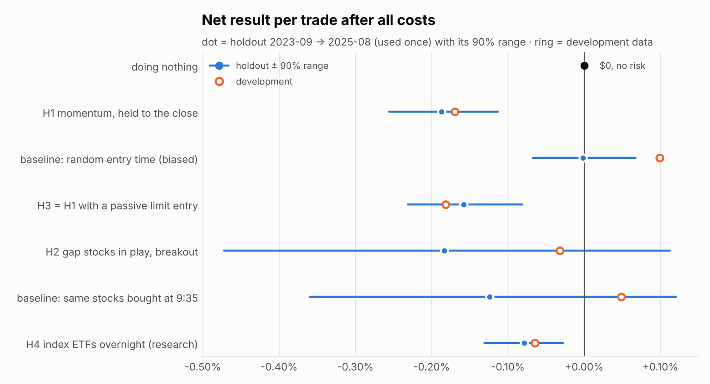
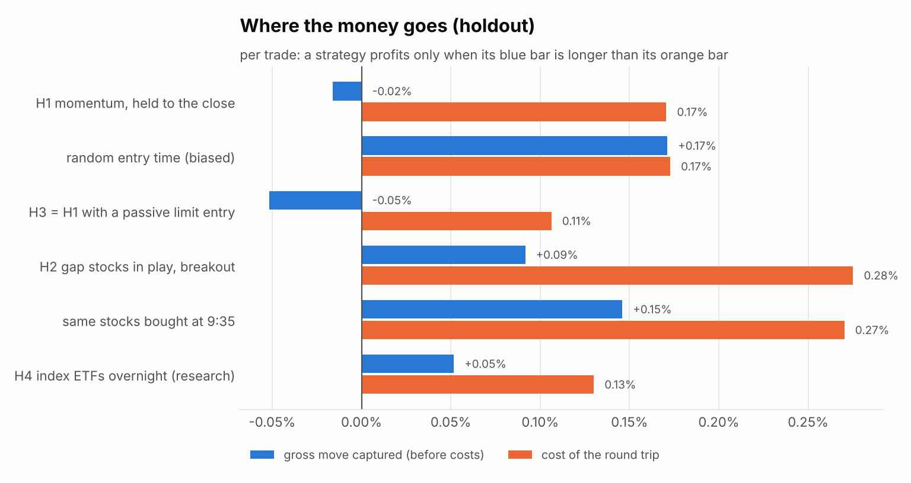
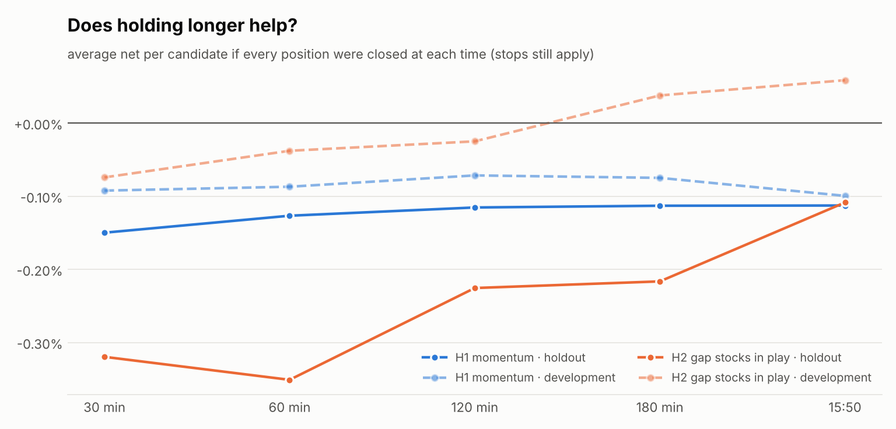

# Research phase 2: looking for a real edge (2026-11-07)

**Result: no strategy passed.** Five hypotheses were pre-registered before any data was downloaded:

* holding longer
* gap "stocks in play"
* passive limit entries
* holding index ETFs overnight
* a multi-day SPY trend filter

On an untouched two-year holdout (2023-09-01 → 2025-08-29, 501 sessions, evaluated **once**), every intraday idea
lost money after costs. The one positive result was the SPY trend filter: +0.06% per day, with a smaller drawdown
than buy-and-hold. After adjusting for testing five ideas it cannot be told apart from luck (Holm p = 0.12). It is
also a multi-day strategy, which the app does not do. For this account, not trading is still the best result we
have measured.

Every number below is regenerated from `dev.json` and `holdout.json` by
`scripts/research_report_phase2.py`; the full tables are in [`tables.md`](tables.md).

## 1. How the study was run

| | |
|---|---|
| Pre-registration | `research/PREREGISTRATION-2026-11-07-phase2.md`, commit `da7f969`, made **before** any phase-2 download |
| Data | Alpaca IEX bars (free feed): daily bars for 513 symbols (curated universe + SPY/QQQ/IWM/DIA); 1-minute bars for the 40-symbol research set; 1-minute bars only on symbol-days whose daily bars gapped ≥ +3% |
| Vault (untouched) | 2020-07-27 → 2022-10-31: registered as reserved, **never downloaded** |
| Warm-up only | 2022-11-01 → 2023-08-31: indicator history (100-day SMA, 14-day volume averages), no results |
| **Holdout (used once)** | **2023-09-01 → 2025-08-29**, marker `research/HOLDOUT_P2_USED.json` |
| Development | 2025-09-02 → 2026-11-05 (already examined in round 1) |
| Costs | Standard: 3 bps quoted spread + 5 bps slippage per side. Gap stocks: 10 bps spread (also tested at 20). SEC $20.60/M; FINRA TAF by date; CAT. Alpaca's rounding of each fee type's **daily** total up to a cent |
| Fills | Decide at a bar's close, act at the next bar's open. A stop is assumed to hit first inside a bar. Gaps fill at the open. Breakouts fill only on a trade ≥ 1 bp through the trigger. Limits fill only on a trade ≥ 1 bp through the limit. A touch is not a fill |
| Account replay | $100 account, $20 positions, 2 slots, one position per symbol, 20-minute cooldown |
| Statistics | Day-block bootstrap (5,000 draws), Holm–Bonferroni across H1–H5 at α = 0.05; pre-registered rejection rules |

**Credentials.** The previously shared paper key was used **only for read-only market-data downloads**. No
brokerage endpoint was called and no order was placed.

**The holdout's one use.** The first attempt (commit `a0b6889`) stopped while *loading* bars, before any hypothesis
was evaluated, because two sessions were missing from the cache:

* 2025-01-09 was an unscheduled market closure.
* 2025-03-10 has no IEX minute bars on Alpaca at all, although its daily bar exists.

Research code now leaves a missing symbol-day missing. The rerun used a guarded flag that only allows a rerun when
every earlier attempt was a recorded load failure. It ran on commit `4f1a646` with the same rules. Both attempts
are in the marker file. The holdout is now marked *examined* in `research/ledger.json`. The only untouched history
left is the vault.

## 2. Diagnosis: why the app's opportunities don't make money



1. **There is no direction in the signals.** The app's momentum and volume-breakout signals, held to the close
   (H1), made **−0.016%** per trade before costs on the holdout (+0.010% on development). Round 1 measured the best
   30-minute signal at about +0.04%. Every round trip costs more than that.
2. **Prices move, but the movement isn't capturable.** An average H1 candidate went +1.01% in its favour and
   −0.67% against it. It reached +0.5% 55% of the time and +1% 33% of the time, yet ended the day near zero. Stops
   took 37% of candidates at −1.2% each; the rest averaged +0.52% at the close.
3. **Holding longer doesn't help** (figure 3). H1's net result moves from −0.15% at 30 minutes to −0.11% at the
   close: slightly less bad, never positive.
4. **The result is mostly the market's direction that day.** H1 made +0.57% per trade on volatile up days and
   −0.64% on volatile down days. That label is only known after the close. A long-only signal set mostly rides
   market beta.
5. **Costs at $20 are a percentage wall.** On the holdout replay, the round trips cost:

   | trade type | cost per round trip |
   |---|---:|
   | H1, liquid large caps | 0.17% |
   | H2, gap stocks | 0.28% |
   | H3, passive entries | 0.11% |
   | H4, overnight ETFs | 0.13% |

   A meaningful part of that is Alpaca rounding each fee type's daily total **up to a cent**. A $20 sale
   owes about $0.0004 in SEC fee but pays $0.01, and CAT is rounded the same way. That adds **+0.04%** per trade
   (H1, several trades a day) to **+0.08%** (H2, about one trade a day) on top of spread and slippage. FINRA's TAF
   returns in 2027 and will be rounded the same way.



## 3. Hypotheses (mechanism → rule)

| | idea | why it might work | rule (frozen before data) |
|---|---|---|---|
| **P2-H1** | A. longer holds | Intraday momentum persists into the close (documented in index futures and liquid stocks) | First momentum/volume-breakout signal per symbol per day, 10:00–14:00. Buy at the next open. Stop at 1–3% (3×ATR). Exit at 15:50 |
| **P2-H2** | B/C. selective, fewer, higher conviction | Stocks gapping up on news, with heavy early volume, keep trending ("stocks in play") | Gap ≥ +3%, price ≥ $5, liquidity in the top half, first 5 minutes green, rvol5 ≥ 2, opening range ≤ 4%. Top 2 by rvol5. Buy-stop at the 5-minute high before 11:00. Stop at the 5-minute low. Exit at 15:50 |
| **P2-H3** | D. execution cost | Resting limit orders earn the spread instead of paying it | H1 with a limit 5 bps under the signal close, valid 10 minutes, filled only on a trade through it |
| **P2-H4** | E. overnight (research only) | Most of the equity premium is earned overnight | Buy SPY/QQQ/IWM/DIA at the close, sell at the next open |
| **P2-H5** | E. multi-day (research only) | Time-series momentum: being out of the market below the 100-day average avoids the worst drawdowns | Hold SPY while it closes above its 100-day SMA. Compared with buy-and-hold |

## 4. Results

| | dev net/trade | **holdout net/trade** | holdout 90% range | trades | verdict |
|---|---:|---:|---|---:|---|
| doing nothing | 0 | **0** | — | 0 | baseline |
| P2-H1 momentum held to the close | −0.169% | **−0.187%** | −0.26% … −0.11% | 1,180 | rejected |
| P2-H3 = H1 with a passive limit entry | −0.182% | **−0.158%** | −0.23% … −0.08% | 1,135 | rejected |
| P2-H2 gap stocks in play (breakout) | −0.032% | **−0.184%** | −0.47% … +0.11% | 278 | rejected |
| P2-H4 index ETFs overnight | −0.065% | **−0.078%** | −0.13% … −0.03% | 1,996 | rejected |
| P2-H5 SPY trend filter (per day) | +0.014% | **+0.060%** | +0.01% … +0.11% | 500 days | rejected (Holm p = 0.12) |

Two baselines:

* The same gap stocks bought at 9:35 instead of on a breakout: +0.048% on development, **−0.124%** on the holdout.
  Its development result looked like a lead worth a later test. The holdout says it was noise, so it won't be
  pursued.
* Random entry times (H1 baseline): **−0.002%** on the holdout. This baseline is *biased upward*: it samples
  symbol-days chosen because a signal fired, so it can buy before the very move that triggered the signal. It is
  reported, not used as evidence.

On the $100 account, the holdout replay lost:

| | loss over 2 years | max drawdown |
|---|---:|---:|
| H1 | $44.09 | $45.45 |
| H3 | $35.88 | |
| H4 | $31.29 | |
| H2 | $10.20 | $15.63 |

None of H1–H4 was profitable in more than 2 of 4 holdout quarters. All of them turn more negative with doubled
slippage.

## 5. Opportunity profiles (holdout, every candidate before slot limits)

| | n | gross | cost | net | avg MFE | avg MAE | reach +0.5% / +1% / +2% | avg hold |
|---|---:|---:|---:|---:|---:|---:|---|---:|
| H1 | 3,251 | +0.018% | 0.130% | −0.113% | 1.01% | −0.67% | 55% / 33% / 14% | 200 min |
| H2 | 278 | +0.092% | 0.200% | −0.109% | 2.07% | −1.44% | 80% / 60% / 39% | 236 min |
| H2 at 9:35 | 349 | +0.146% | 0.200% | −0.054% | 1.92% | −1.13% | 71% / 55% / 34% | 183 min |

MFE and MAE are the best and worst points a trade reached; reach is the share of trades that touched each gain.
The "cost" column here is spread, slippage and per-trade fees *without* the daily cent rounding (the account
replay above includes it).

Gap stocks really do move: 60% reached +1%. But they reverse as often as they continue. The median trade gave
back all of its best excursion (capture ratio −0.34). Choosing a profit target from these MFE numbers would be
fitting to the holdout, so it was not done. A target rule would have to be pre-registered and tested on the vault.



| net if closed at | 30 min | 60 min | 120 min | 180 min | 15:50 |
|---|---:|---:|---:|---:|---:|
| H1 holdout | −0.150% | −0.127% | −0.115% | −0.113% | −0.113% |
| H2 holdout | −0.320% | −0.351% | −0.226% | −0.216% | −0.109% |

## 6. Execution: passive limit orders (H3)

| | signals | limit filled | H1 result on signals where the limit filled | where it didn't |
|---|---:|---:|---:|---:|
| development | 1,774 | 75.9% | −0.192% | +0.191% |
| holdout | 3,251 | 74.2% | −0.195% | +0.123% |

Resting 5 bps under the signal price halved the cost (0.065% instead of 0.130% per candidate). But the order fills
mainly when price falls back, which is when the signal is failing, and misses the trades that run away. The
filled trades were 0.32 points worse than the missed ones. Net effect: about +0.03% per trade better than H1,
still −0.16% after costs. This is adverse selection, and an honest simulation has to model it.

## 7. Overnight and multi-day (research only, never enabled in the app)

* **H4, overnight index ETFs:** +0.052% gross per night, −0.078% net. With tight costs (1 bp spread, 1 bp
  slippage) it would be +0.022%. Gap risk is real:
  * worst night −5.4% (IWM, 2024-08-05)
  * 1st percentile −2.5%
  * 25 ETF-nights at −2% or worse in two years

  A broker-side stop does not protect against an opening gap.
* **H5, SPY above its 100-day average:** over 500 holdout days, +33% (Sharpe 1.38, worst drawdown 8.4%), against
  buy-and-hold's +43% (Sharpe 1.21, worst drawdown 19.0%). It switched only 9 times.
  * It met the pre-registered comparison with buy-and-hold: equal or better Sharpe and a smaller drawdown.
  * It failed the multiple-comparison test: Holm p = 0.12, against a 0.05 threshold.
  * On development (198 days) it was worse than buy-and-hold: Sharpe 0.30 vs 0.63.

  It is a slow, well-known risk-management rule, not a trading edge. Using it would mean holding positions for
  weeks, which is outside the app's approved scope.

## 8. Does a model or filter help? (deliverable E)

The pre-registered ML step was conditional on the **unfiltered** development result being positive. Neither H1
(−0.169%) nor H2 (−0.032%) was, so it did not run: filtering a population with no edge mostly adds false
discoveries. For completeness, here are the pre-registered deterministic filters on **development** candidates.
These are descriptive only, not a test:

| | n | gross | net |
|---|---:|---:|---:|
| H1 unfiltered | 1,774 | +0.032% | −0.099% |
| H1 + relative volume ≥ 2 and SPY above VWAP | 348 | +0.102% | −0.029% |
| H2 unfiltered | 194 | +0.260% | +0.059% |
| H2 + rvol5 ≥ 4 | 79 | +0.078% | −0.123% |

The H1 filter improves the gross result but still loses after costs, and it was chosen with hindsight about which
features matter. The existing statistical model (`strategy-filter-v1`) was evaluated on round 1's untouched holdout:

* Its win probabilities were calibrated and slightly informative (AUC 0.61).
* It could not rank the *size* of results (AUC 0.49).
* Correctly, it took no trades.

**Conclusion: unfiltered < filtered < no trade.** No model or filter tested has turned a negative population
positive.

## 9. Threats to validity

These are all reasons the results could look *better* than reality, not worse:

* The curated universe is today's list, so it has survivorship bias.
* Spreads on gap stocks at 9:35 are often wider than 10 bps.
* IEX volume is roughly 2–3% of consolidated volume, so relative-volume measures are noisy.
* The random-time baseline is biased upward, as noted in section 4.

The two missing sessions (2025-01-09 and 2025-03-10) are 2 of 501 holdout days.

## 10. What happens next

* **Forward evidence, not more history.** From build 33 the app records every eligible candidate, taken or
  rejected, at the moment it is seen. It also records the gap-stock (H2) candidates each morning as a shadow
  observer. Each record is in an append-only, hash-chained table, and is scored after the close against bars that
  started after the decision (`dkapp/research/forward.py`, Performance → *forward evidence*). Outcomes never feed
  back into predictions.
* **The vault is the last clean test.** Any new idea must be pre-registered and tested once on 2020-07-27 →
  2022-10-31. After that, only forward data is unseen.
* **What would have to change for this account to profit:**
  * Gross edge per trade above about 0.17% for liquid stocks, or 0.28% for gap stocks.
  * Or costs cut below the gross results measured here (+0.02% to +0.15%).

  Neither is in reach at $20 positions on a free data feed. A larger position reduces only the rounding part,
  which is about 0.04–0.08 points.

## Reproduce

```
python scripts/download_phase2.py daily   DATA/daily            # read-only market data
python scripts/download_phase2.py gapdays DATA/daily 2023-09-01 2025-08-29 DATA/gap_hold
python scripts/download_phase2.py minute  -  2023-08-17 2025-08-29 DATA/min_hold
python scripts/research_phase2.py dev     DATA research/runs/2026-11-07-phase2
python scripts/research_report_phase2.py  research/runs/2026-11-07-phase2 DATA/dev_candidates.pkl
```

The holdout command (`research_phase2.py holdout …`) refuses to run again: the marker records its one use.
