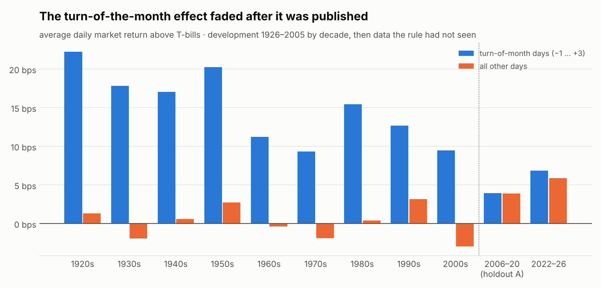
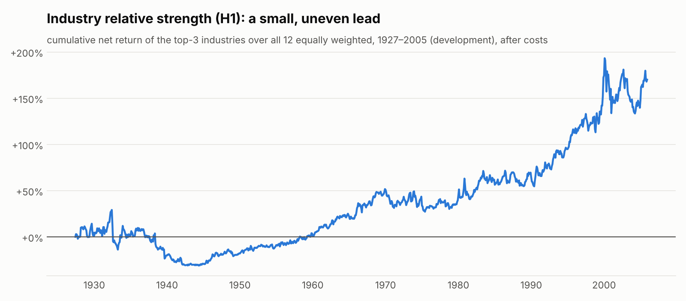
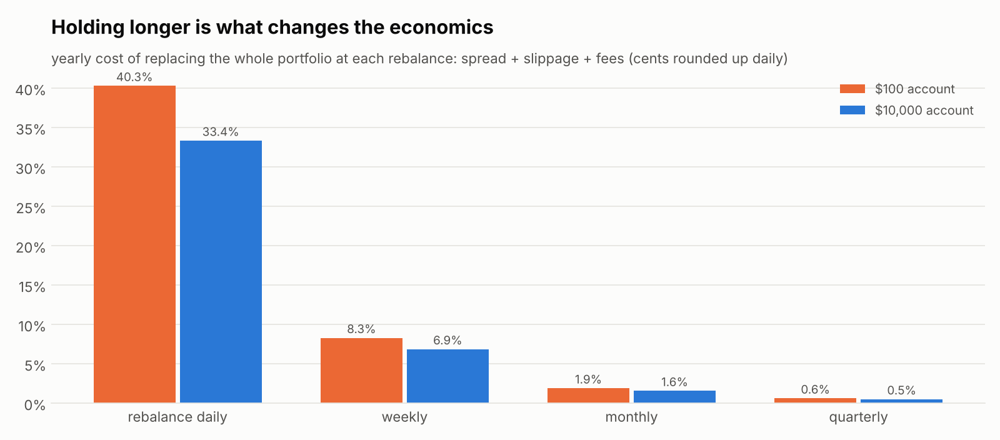

# Research phase 3: holding for days and weeks (2026-11-07)

**Result: no multi-day strategy passed.** Phase 3 moved away from intraday trading to two low-turnover
strategies with long academic records:

* **Industry relative strength (H1):** hold the 3 strongest of 12 industries, rebalanced monthly.
* **The turn of the month (H2):** hold the market from the second-to-last trading day of each month through
  the third trading day of the next.

Holding for weeks solves the cost problem. Trading costs fall from about 34–40% a year with daily turnover to
under 2%. Neither rule kept an edge on data it had not seen:

* **H1** beat the equal-weight industries by a statistically weak +0.13% a month on development data. That was
  too small to survive the correction for how many ideas were examined (deflated Sharpe 0.34 against the 0.95
  required).
* **H2** worked in every decade from 1926 to 2005: +0.52% per monthly window after costs. It then
  **disappeared** on the untouched 2006–2020 holdout: +0.04% per window, p = 0.40. Turn-of-month days earned
  3.95 bps against 3.89 bps on other days.

The vault (July 2020 → October 2022) was **not opened and never downloaded**. No candidate earned it.

All numbers are regenerated from `review.json`, `dev.json`, `dev_ml.json` and `holdout.json` by
`scripts/research_report_phase3.py`. Full tables are in [`tables.md`](tables.md).

## A. Established methods and software that were evaluated

Each package was read at source level (PyPI wheels/sdists and the Lean repository), not from marketing pages.

| project | licence | what it does well | used? |
|---|---|---|---|
| **alphalens-reloaded** 0.5.1 | Apache-2.0 | Factor tear sheets: rank IC and its t-stat, mean return by quantile, IC decay, factor turnover (rank autocorrelation). It does **not** model costs | **Adopted** (research-only environment, `requirements-research.txt`). It independently reproduced our IC exactly (+0.0764 vs +0.0764) |
| **Deflated Sharpe ratio / probabilistic Sharpe** (Bailey & López de Prado 2012, 2014) | method | Corrects a Sharpe ratio for the number of strategies tried, for sample length, skew and fat tails | **Adopted** (`dkapp/research/stats.py`, no dependency). It decided H1's fate |
| qlib 0.9.7 (Microsoft) | MIT | Separates signal evaluation (IC, Rank IC, ICIR, long-short) from portfolio backtesting. Its `TopkDropoutStrategy(topk, n_drop)` caps turnover. Exchange costs (`open_cost`, `close_cost`, `min_cost`), limit thresholds, rolling retraining | Not adopted. Its dependencies are heavy (mlflow, redis, pymongo, cvxpy, gym) and its defaults suit Chinese A-shares (5-yuan minimum cost). We borrowed the IC/ICIR reporting and the turnover-capping idea |
| pybroker 2.0.2 | Apache-2.0 **+ Commons Clause** | BCa bootstrap confidence intervals for Sharpe and profit factor, `walkforward(windows, lookahead, train_size)`, `buy_delay` | Not adopted. The licence restricts selling, and its default fill price is the bar midpoint (optimistic). Our day/month-block bootstrap is already more conservative for autocorrelated returns |
| QuantConnect Lean | Apache-2.0 | `EquityFillModel` (stop fills at the open when the price gaps through), `VolumeShareSlippageModel` (quadratic impact), `DelayedSettlementModel` (T+N cash settlement) | Not adopted (C# engine). We copied the T+1 settlement idea as a sensitivity (`buy_delay=1`). Lean's `AlpacaFeeModel` charges US equities **nothing**, so it ignores the SEC/TAF/CAT fees and the daily cent rounding our cost model includes |
| quantstats 0.0.86 | Apache-2.0 | Tear sheets and benchmark comparison; ulcer index, tail ratio, CVaR, Monte Carlo drawdowns | Not adopted. We already compute the metrics that matter, and it pulls in `yfinance` |
| vectorbt 1.2.0 | Apache-2.0 **+ Commons Clause** | Very fast vectorised parameter sweeps | Not adopted. The licence restricts selling, and mass parameter sweeps are exactly the overfitting this project is guarding against |
| nautilus_trader 1.231 | LGPL-3.0 | Event-driven, order-book-level simulation; `FillModel(prob_fill_on_limit, prob_slippage)`; latency models | Not adopted: overkill for daily and monthly strategies. Its probabilistic limit fills support the phase-2 adverse-selection finding |
| StockSharp | **custom, all rights reserved** (EULA) | C# trading platform | Architectural reference only. Its licence is not open source |

**What mature frameworks do that we now also do:**
* Keep factor evaluation (IC, quantiles, turnover) separate from strategy P&L.
* Charge costs on turnover and model settlement.
* Count trials before believing a Sharpe ratio.
* Validate with walk-forward.

**What none of them supply:** an edge.

## B. The two hypotheses, and why they were plausible

Both were frozen in `research/PREREGISTRATION-2026-11-07-phase3.md` (commit `a66b9c7`) **before** any
strategy-level backtest. That was after a development-only review of 36 factor/condition trials, all of which
are counted.

| | mechanism | evidence before this study |
|---|---|---|
| **P3-H1 industry relative strength** | Investors under-react to industry news and capital moves slowly, so industry returns persist for 3–12 months | Moskowitz & Grinblatt (1999); Asness, Moskowitz & Pedersen (2013). Our review: 49-industry 12-1 momentum IC +0.074 (t = 7.6) in 1926–2005; a long-only top-10 portfolio beat equal weight by +4.4%/yr net |
| **P3-H2 turn of the month** | Pay-days, pension contributions and fund flows arrive around month-end, and institutions raise cash before it. The calendar is known in advance, so no look-ahead is possible | Ariel (1987); Lakonishok & Smidt (1988); McConnell & Xu (2008); Etula et al. (2020). Our review: +14.8 vs +0.2 bps/day (t = 8.2), and 95% of the market's excess return came on these days in 1926–2005 |

**Data.** Ken French's daily value-weighted industry and market returns. They are survivorship-free (every
CRSP stock) and include dividends. The 1-month T-bill rate comes from the same files.

**Data checks.** We checked the series against the app's own Alpaca ETF bars for 2022–2026 (`etf-validation.txt`):

* The market series vs SPY: correlation 0.994.
* Industries vs sector ETFs: 0.80–0.99, except XLC at 0.61, because Google and Meta are "business equipment" in
  French's scheme.
* The check also found 2-for-1 splits on 2025-12-05 in the raw bars of XLE, XLK, XLU, XLB and XLY. The app
  stores raw prices, which is why multi-day work now requests adjusted bars.

**Periods** (`research/ledger.json`):

| period | dates | status |
|---|---|---|
| Development | 1926-07 → 2005-12 and 2022-11 → 2026-09 | exploratory work and pass criteria |
| **Holdout A** | **2006-01 → 2020-07** | **reserved before download, split into separate files, used once** |
| Vault | 2020-07-27 → 2022-10-31 | untouched |

## C. Development results (1926–2005; costs: 1.5 bps half-spread + 5 bps slippage per side + fees)

| | n | primary result (net) | 90% range | p | 2× costs | decades positive | deflated Sharpe | verdict |
|---|---:|---:|---|---:|---:|---:|---:|---|
| **H1** top 3 of 12 industries vs equal weight | 943 months | **+0.130%/month** | +0.01% … +0.25% | 0.031 | +0.10% | 6 / 8 | **0.002** (0.34 with an H1-only variance floor) | **rejected** |
| **H2** turn-of-month window, cash at 0% | 953 windows | **+0.516%/window** | +0.41% … +0.62% | < 0.001 | +0.39% | 8 / 8 | 0.997 | passes |

**H1** made 11.7%/yr against 10.2% for equal-weight industries and 9.3% for the market. Its drawdowns were the
market's (−81%). Its picks averaged the 54th percentile of all 220 possible top-3 combinations. The lead was
uneven: −30% from 1932 to 1944 and flat from 1966 to 1990. All four sensitivity variants (top 2, top 4, 6-1,
12-0) were positive. They are counted as trials, not chosen.

**H2**, with cash earning 0%:

| | H2 | market |
|---|---:|---:|
| return per year | 5.8% (8.7% with T-bill cash) | 9.5% |
| Sharpe against T-bills | 0.37 (0.77 with T-bill cash) | 0.43 |
| worst drawdown | −25% | −84% |
| time in the market | 18% | 100% |

Every decade was positive, and 26 of 27 three-year blocks.

**Recent development data, 2022-11 → 2026 (low power, reported only):**
* H1: +0.13%/month (p = 0.41). On the 11 SPDR sector ETFs: +0.17%/month (p = 0.33).
* H2: +0.21%/window (p = 0.21). On SPY: +0.21%/window (p = 0.19). Turn-of-month days 6.8 bps vs 5.9 bps on
  other days, so the gap had already shrunk.

## D. Independent test (holdout A, 2006-01-03 → 2020-07-24, used once, commit `7e7edbc`)

Only H2 qualified.

| H2 | holdout A | development |
|---|---:|---:|
| net per window (cash 0%) | **+0.038%** (90%: −0.24% … +0.31%), Holm p = 0.40 | +0.516% |
| turn-of-month vs other days | 3.95 vs 3.89 bps/day | 14.8 vs 0.2 |
| gross per window vs random 4-day windows | 0.152% vs 0.142% | 0.593% vs 0.052% |
| 2× costs | −0.092% | +0.385% |
| realistic SPY costs (0.5 bps spread, 1 bp slippage) | +0.143% (p = 0.20) | +0.622% |
| return per year / Sharpe / worst drawdown | 0.2% / −0.08 / −22% | 5.8% / 0.37 / −25% |
| market over the same days | 9.2% / 0.48 / −55% | 9.5% / 0.43 / −84% |

**Verdict: rejected.** It failed three pre-registered criteria: Holm p ≥ 0.05, negative at 2× costs, and Sharpe
below half of buy-and-hold's.

This is a textbook case of an anomaly fading after publication. McLean & Pontiff (2016) found published
anomalies earn on average 58% less after publication. Here the effect disappeared almost entirely.

**The vault stays untouched**, as the pre-registration requires. Holdout A is now marked examined.

## E. Did machine learning help?

The pre-registered ML step ran only for the hypothesis that passed development. **H2-ML** was a logistic
regression (the app's own L2 model) predicting which turn-of-month windows would beat cash, from three
features:

* market trend
* a volatility tercile
* industry breadth

It was walk-forward on 1946–2005, refit every January. The result:

* It predicted "take it" for **every** window. The base rate of a winning window is 64%.
* So the filtered strategy was identical to the plain one: improvement 0.000%, p = 1.0.
* Directional skill: AUC 0.52. Brier score 0.2304, slightly *worse* than the base rate's 0.2293.

**Rejected.** These conditions do not predict which windows pay.

H1-ML was not run, because H1 failed development. Running a model search after a failed deflated-Sharpe test
is the forking path the pre-registration exists to prevent.

The phase-1 statistical model (AUC 0.61 on direction, 0.49 on the size of results) remains the only one with
any calibrated directional signal. It has never produced a profitable selection.

## F. Economics at realistic capital levels (simulation; no leverage; fractional shares, $1 minimum)

| | $100 | $500 | $1,000 | $5,000 | $10,000 |
|---|---:|---:|---:|---:|---:|
| H1, development, return per year (cost per year) | 11.62% (0.40%) | 11.67% (0.36%) | 11.68% (0.35%) | 11.69% (0.34%) | 11.69% (0.34%) |
| H2, development | 5.69% (1.58%) | 5.76% (1.52%) | 5.77% (1.51%) | 5.77% (1.51%) | 5.78% (1.51%) |
| H2, holdout A | −0.31% (2.07%) | +0.09% (1.67%) | +0.13% (1.62%) | +0.17% (1.59%) | +0.17% (1.59%) |
| owning the market, 2006–2020: average $/month at 9.2%/yr | $0.74 | $3.68 | $7.37 | $36.84 | $73.69 |
| owning the market, 2006–2020: worst drawdown in $ | −$55 | −$273 | −$546 | −$2,728 | −$5,457 |

What the table shows:

* At monthly turnover, account size barely matters. Fee rounding costs a $100 account about 0.07%/yr more than
  a $10,000 one. Account size was the binding problem only for frequent $20 trades.
* T+1 settlement (buying a day after selling) costs H1 about 0.3–0.4%/yr.
* A strategy that loses before costs loses at every size. Scaling does not rescue it.
* The only reliably positive return in this data is **owning the market**: about 9% a year over 1926–2020,
  with drawdowns of 55–84%. That is the equity risk premium, not alpha.
* At 9%/yr, $1,000/month of *average* income would need roughly $130,000 of capital, and some years would
  still lose a third of it.

## G. What was implemented

**Research tooling:**
* `dkapp/research/academic.py`: ledger-enforcing loaders and a one-time holdout marker.
* `dkapp/research/factors.py`: point-in-time factors and IC.
* `dkapp/research/portfolio.py`: a long-only daily portfolio simulator with spread, slippage, per-type daily
  cent-rounded fees, a $1 minimum, a T+1 option, and no leverage.
* `dkapp/research/phase3.py`: the frozen rules.
* Deflated Sharpe ratio, probabilistic Sharpe ratio and a moving-block bootstrap.
* `scripts/download_phase3.py`: vault rows are dropped in memory and never written.
* The review, development, ML and report scripts.

**App:**
* `dkapp/research/daily_shadow.py`: forward shadow records for multi-day rules (H1 on sector ETFs, H2 on SPY,
  and an SPY benchmark).
  * Each decision is recorded in its own window from that day's adjusted closes. It is never backfilled; a
    missed window is counted as missed.
  * Holdings are scored only after they end.
  * No orders.
* Adjusted daily bars added to the data layer (opt-in).
* The Performance page shows the multi-day shadow table and a phase-3 evidence card.
* `scripts/forward_report.py` reports both views.

**Audit fix:** the 9:35 gap observer stamped its records at 9:35 even when it ran up to 15 minutes later. It
also picked stocks using prices from that later moment, so a breakout in between could be credited. It now
stamps the real decision time, so outcomes use only later bars.

## H. Strongest remaining direction

Three phases have now tested twelve pre-registered hypotheses. They covered intraday momentum, mean reversion,
stocks in play, execution tactics, overnight holding, calendar effects and industry momentum. Every one failed
out of sample. The well-documented anomalies that need only free price data have largely been arbitraged away
since publication.

1. **Stop searching price-only timing and selection rules in US equities with free data.** More of the same
   would mostly be multiple testing.
2. **If the goal is positive expected return with this app,** the defensible path is broad, low-cost market
   exposure.
   * Expect the market's risk premium, with its drawdowns, and no edge.
   * A slow trend filter optionally reduces drawdowns. Phase 2 H5: Sharpe 1.38 vs 1.21, drawdown 8% vs 19%,
     but not significant.
   * This would be an "investing mode": multi-day holding, which needs your explicit approval and an
     overnight-risk design. It should be framed as investing, not as a trading edge.
3. **A genuinely new edge needs new information,** for example:
   * point-in-time fundamentals (value, quality, profitability)
   * earnings surprises (post-earnings drift)
   * analyst revisions
   * order-flow data

   These require paid data and your approval. The vault should be spent only on a candidate built on such
   information that first passes development.
4. **Keep the forward shadow running.** It costs nothing, it is the only truly unseen evidence, and it will show
   if any rule's behaviour changes.

## I. Are we closer to a profitable trading system?

**No.**
* The infrastructure is better: honest multi-day simulation, factor tooling, overfitting-aware statistics and
  forward shadow monitoring.
* The economics are understood: holding longer removes the cost problem.
* But no strategy has shown an edge on unseen data, and none should trade.

What we *are* closer to is knowing where an edge is **not**. That is real progress, but it is not
profitability.
