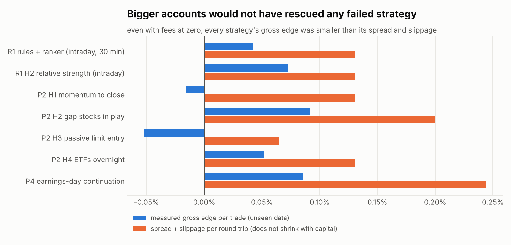
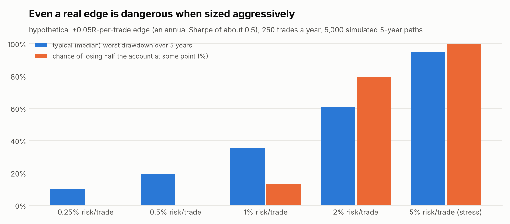
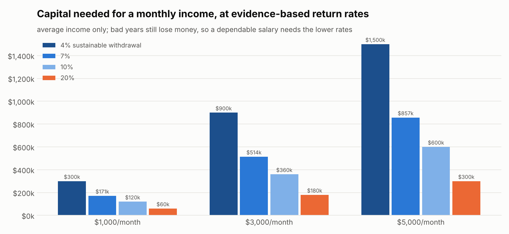

# Strategic research reset: where trading profits come from, and what we can reproduce (2026-11-07)

**Decision: NO VIABLE RETAIL APPROACH IDENTIFIED for salary-level trading income.**

The businesses that make reliable trading profits are market makers and a few elite funds. They earn from
spreads, rebates, order flow, speed and scale. A retail account on Alpaca cannot reproduce any of these.

The returns an individual *can* reproduce are risk premia: equity exposure, trend-following, merger
arbitrage. These are documented over decades. They pay roughly cash plus a few percent to market-like
returns, with long drawdowns. At those rates, $1,000–$5,000 a month needs about **$120,000–$1.5 million**
of capital, not a better algorithm.

Our 13 failed hypotheses failed because their **gross edge was smaller than unavoidable trading costs** (or, for
the multi-day ones, was not statistically real), not because the account was small. More capital would only have produced larger dollar losses.

If one more pilot is wanted, the only one I can justify is collecting evidence for **long-only merger
arbitrage**: structural, retail-accessible, and testable with our existing EDGAR tooling. Even if it works, its
realistic return would not change the income conclusion.

Evidence labels used below:
* **[V]** verified from a primary or audited source
* **[R]** reported second-hand: press, books, or the firm's own unaudited claims
* **[I]** my inference
* **[U]** unknown or proprietary

Sources are listed at the end.

---

## A. Proven quantitative trading operations

| operation | what can be established | evidence |
|---|---|---|
| **Virtu Financial** (public) | 2024 revenue **$2.88 bn**; Adjusted Net Trading Income **$1.60 bn**, of which market making **$1.20 bn**; **969 employees**; quotes in **25,000+ instruments on 250+ venues in 40 countries** [V]. Costs: **$674 m** for exchange, clearing and order-flow payments; **$236 m** for co-location, network and data [V]. In its own words: "our profitability per trade and per instrument is not significant, particularly in U.S. equities" [V]. Wider spreads in volatile markets raise its "capture rate per notional amount transacted" [V]. Its IPO filing reported **one losing day in 1,238** (2009–2013) [V] | 10-K FY2024 and S-1 2014 on SEC EDGAR |
| **Jane Street** (private) | **~$20.5 bn** net trading revenue in 2024, about double 2023; members' equity **$29.9 bn**; **~$6.9 m revenue per employee** [R, from its bond offering documents as reported by the press] | IFRE, FI-Desk, BNN Bloomberg |
| **Citadel Securities** (private) | **~$9.7 bn** net trading revenue in 2024 [R]. The largest destination for US retail order flow; paid **~$951 m** for retail options and equity flow in April–December 2024, per brokers' Rule 606 reports [R] | Global Trading; Bloomberg via secondary sources |
| **IMC** (publishes an annual report) | **$2.235 bn** net trading revenue in 2024 (up 63%); net profit **$686 m** [V, company report] | IMC 2024 annual report |
| **Hudson River Trading** (private) | **~$8 bn** net trading revenue in 2024 [R, anonymous sources] | Business Insider via secondary sources |
| **Renaissance Medallion** | About **66% a year before fees and 39% after, 1988–2018** [R, Zuckerman 2019]. Fees of 5% of assets and 44% of profits; employee-only; capacity-limited [R]. Its methods are **unknown** [U]. Renaissance's funds for **outside** investors (RIEF) **lost about 19% in 2020 while Medallion gained 76%**, and returned 9.1% a year since inception against the index's 9.7% [R, Bloomberg / Institutional Investor]. So the firm's public funds do not share Medallion's edge [I] | |
| **Jump, DRW** | No reliable public financials found [U] | — |

Platforms and public records:

| source | what the evidence shows |
|---|---|
| **Collective2** | All results are "hypothetical", including "verified" ones. Commissions and subscription fees are not included [V, C2's own disclaimers]. A study of its systems found survivorship bias, with a median system age of only **6 months** [R, CXO Advisory] |
| **Myfxbook** | No rigorous study of how many accounts are profitable. Only owner-published accounts appear, so the visible sample is biased upward [I]. Verification shows the data came from a broker, not that the strategy is repeatable [R] |
| **QuantConnect** | Alpha Streams was shut down (about February 2022). **No published live performance record found** [R] |
| **Quantopian** | Its crowd-sourced market-neutral fund **trailed the S&P 500 by 62 percentage points over five years** and closed in 2020 [R, Bloomberg/HFR]. Its own study of **888 algorithms** found backtest Sharpe ratios explained only **R² ≈ 0.01–0.02** of live results [R, Wiecki et al. 2016] |

Retail populations, from regulators' complete records:

| market | finding |
|---|---|
| **Brazil** (all mini-index futures day traders 2013–2015) | Of those who kept going for 300+ days, **97% lost money** and only **1.1% earned more than the minimum wage**. There was no evidence of learning [V, Chague, De-Losso & Giovannetti 2019] |
| **Taiwan** (1992–2006) | **Less than 1%** of day traders predictably earned positive returns after fees. The group's aggregate net was negative in every one of 15 years [V, Barber, Lee, Liu & Odean 2014] |
| **EU** (CFDs) | **74–89% of retail accounts lose money** [V, ESMA 2018] |
| **US retail options** (Nov 2019 – Jun 2021) | About **$1.14 bn** lost, plus **$4.13 bn** in trading costs [V, Bryzgalova, Pavlova & Sikorskaya, Journal of Finance 2023] |

Systematic strategies with real-money records:

| strategy | live record |
|---|---|
| **Managed futures** (SG Trend Index, since 2000) | Sharpe ratio about **0.56** against the S&P 500's 0.51. A "lost decade" 2009–2018, then a record **+27% in 2022** [R] |
| **Merger arbitrage** (The Merger Fund, since 1989) | About **4.7% a year compound**, maximum drawdown about −21%, worst rolling 10-year return about 2% a year [R, fund data aggregators and the Virtus fact sheet] |
| **Momentum factor ETF** (MTUM, since 2013) | Roughly **+1–2% a year** ahead of the S&P 500 over 10 years [R]. Figures vary by source and date |
| **AQR Style Premia** (long/short factors) | **−41%** peak to trough over 2018–2020 [R] |
| **Numerai** | **+25%** in 2024 after **−17%** in 2023 [R, self-reported] |

---

## B. Sources of profit: who pays, and why it persists

| mechanism | who pays the trader | why it persists, or fades | evidence |
|---|---|---|---|
| **Market making / liquidity provision** | Traders who want immediacy pay the spread. Retail flow is the easiest to trade against. Exchanges pay rebates | Scale economics: a tiny profit per trade on enormous volume, real-time risk control, and payment for order flow that locks in retail flow. It persists for the few firms at scale | Virtu 10-K [V]; Alpaca's 606 report [V] |
| **Statistical arbitrage / relative value** | Investors whose orders temporarily push prices away from value, before they revert | **Fades with competition.** The daily return of a contrarian long/short strategy fell from **1.38% (1995) to 0.13% (2006–07)** [R, Khandani & Lo 2007]. PCA stat-arb Sharpe fell from **1.44 to about 0.9 after 2003** [V, Avellaneda & Lee 2010] | |
| **Intraday directional prediction** | Other traders. It is zero-sum before costs, and the counterparties are faster and better-informed | Doesn't persist for retail: under 1% of day traders are reliably profitable [V]. Our 9 intraday hypotheses had gross edges of −0.05% to +0.09% per trade | Our ledger; Barber et al.; Chague et al. |
| **Event / information trading** | Slower traders | Speed decides who captures it, and published drifts decay. Post-earnings drift **disappeared from non-micro-cap stocks by about 2006** [R, Martineau 2022]. Published anomalies earn **58% less after publication** on average [V, McLean & Pontiff 2016]. Phase 4 found no edge after the open | |
| **Systematic risk premia** (equity premium, trend, carry, value/momentum) | Investors and hedgers who pay to shed risk: they sell into crises, hedge, or need liquidity | **Persists because it is compensation for real risk.** That is also why it has long, deep drawdowns. World equities returned about **5.2% a year real over 125 years** [R, DMS 2025]. Trend-following has a century of evidence: net Sharpe about **0.77 in 1880–2013** under 2/20 fees [R, Hurst, Ooi & Pedersen working paper] | |
| **Merger (risk) arbitrage** | Target shareholders who sell rather than wait, and acquirers' deal risk. It is effectively insurance against a deal failing | A premium for bearing deal-break and liquidity risk. About **4% a year excess after costs, 1963–1998, 4,750 deals** [V, Mitchell & Pulvino 2001]. It becomes correlated with the market in downturns [V] | |
| **Volatility risk premium** (selling options) | Buyers of insurance | Persistent, but **options are not authorized** | — |

---

## C. Institutional vs retail

**Not reproducible on a retail Alpaca account:**

* **Market making.**
  * Alpaca routes **about 95% of customer orders to Citadel (35%), Jane Street (33%) and Virtu (27%)**. It is paid **12% of the spread** on marketable orders and **20 mils a share** on resting orders [V, Alpaca 606 report, Q2 2026].
  * An Alpaca customer is the *source* of market makers' profits. There is no exchange membership, maker rebate or co-location.
  * Exchange access fees, which fund rebates, were capped at **$0.001 a share** from 2024 [V, SEC Rule 610 amendments].
* **Latency arbitrage and news speed.** Phase 4 showed the app's IEX feed is not even the real price.
* **Statistical arbitrage.** It needs short selling (not authorized) and cheap leverage, and it has decayed.
* **Medallion-style trading.** Its methods are unknown and its capacity is limited.

**Reproducible:**

* Low-turnover risk-premium portfolios using ETFs, which cost **0.2–0.5% of capital a year** to run.
* Trend rules on ETFs, long-only, moving to cash when trends turn down.
* Long-only merger arbitrage in **cash** deals. Stock deals need a short hedge.
* Factor tilts.

All of these hold positions for days to months. Multi-day holding needs your approval and an overnight-risk
policy, because broker stops do not protect against opening gaps.

---

## D. Capital and risk analysis

Simulation code: `scripts/reset_capital_risk.py`. Results: `capital_risk.json` and the figures in this folder.
Positions follow the app's 2-slot, 20% sizing. Fees are aggregated per day, as Alpaca does.

**What capital would have fixed:**

| failed hypothesis (result on unseen data) | gross per trade | net at $100 | net at $10k | net at $100k | best possible (fees 0) |
|---|---:|---:|---:|---:|---:|
| R1 rules + ranker | +0.042% | −0.14% | −0.10% | −0.12% | −0.09% |
| R1 relative strength | +0.073% | −0.14% | −0.07% | −0.09% | −0.06% |
| P2 momentum to close | −0.016% | −0.21% | −0.16% | −0.17% | −0.15% |
| P2 gap stocks in play | +0.092% | −0.26% | −0.13% | −0.16% | −0.11% |
| P2 passive limit entry | −0.052% | −0.18% | −0.13% | −0.15% | −0.12% |
| P2 ETFs overnight | +0.052% | −0.12% | −0.08% | −0.08% | −0.08% |
| P4 earnings-day continuation | +0.086% | −0.20% | −0.18% | −0.21% | −0.16% |

* **Larger capital fixes exactly one thing:** the cent-rounded fees, about 0.04–0.11% per trade at $20, which
  shrink toward zero above roughly $1,000 positions.
* **It fixes nothing else.** Spread and slippage (0.07–0.24% per round trip) are a percentage of the trade.
* **Above about $25,000** positions, market impact (the square-root law) starts adding cost.
* **None of the seven failures simulated here becomes profitable at any account size.** The phase-3 multi-day
  failures were rejected on gross edge before costs, so capital cannot help them either.

**Cost drag depends on trading frequency, not account size** (yearly cost as % of capital):

| style | $100 | $1,000 | $10,000 | $100,000 |
|---|---:|---:|---:|---:|
| intraday, about 2 round trips a day, liquid stocks | 33.8% | 27.5% | 28.6% | 33.9% |
| intraday on news stocks (phase-4 costs) | 56.8% | 51.1% | 53.9% | 64.6% |
| swing, about weekly | 4.8% | 3.5% | 3.6% | 4.4% |
| monthly ETF rebalance, 50% turnover | 0.5% | 0.2% | 0.2% | 0.2% |

**Fee aggregation audit:**
* Phase 4 charged each $20 trade the full cent-rounded fees, about 0.11%, as if it were the only trade that
  day. It averaged 3.2–3.8 trades a day, so per-day aggregation gives about **0.03%**.
* Corrected, P4-H1 is still **−0.19% per trade** in evaluation (90% range −0.34% … −0.02%) and −0.23% in
  development. The verdict is unchanged.
* Phases 2 and 3 already aggregated fees per day.

**Risk per trade.** This Monte Carlo uses 5,000 paths of 5 years, 250 trades a year, 55% losers at −1.05R and
exponential winners. R is the amount risked per trade. "−0.07R" is roughly what our strategies actually
showed:

| edge | annual Sharpe | risk per trade | median year | 5th-percentile year | P(losing year) | median worst drawdown (5 years) | P(losing half) | P(losing 90%) |
|---|---:|---|---:|---:|---:|---:|---:|---:|
| −0.07R (our reality) | −0.84 | 1% | −18% | −41% | 83% | 69% | 90% | 0.4% |
| 0 (no edge) | 0 | 1% | −3% | −32% | 55% | 46% | 41% | 0% |
| +0.05R (good) | 0.51 | 0.25% | +2.8% | −6.6% | 32% | 10% | 0% | 0% |
| +0.05R | 0.51 | 0.5% | +5.4% | −13% | 33% | 19% | 0% | 0% |
| +0.05R | 0.51 | 1% | +9.5% | −25% | 35% | 36% | 13% | 0% |
| +0.05R | 0.51 | 2% | +13.5% | −47% | 39% | 61% | 79% | 1.2% |
| +0.05R | 0.51 | **5% (stress)** | **−7.3%** | −85% | 53% | 95% | 100% | 72% |
| +0.10R (excellent) | 0.97 | 1% | +24% | −17% | 20% | 30% | 2.9% | 0% |
| +0.10R | 0.97 | **5% (stress)** | +60% | −77% | 35% | 89% | 100% | 45% |

The longest losing streak is a median of 8 and a 95th percentile of 12 trades in a year, at every risk level.

**What this means:**
* With no edge, any risk level just loses money more slowly or faster.
* With a good edge, 0.25–1% risk per trade is survivable.
* 2% invites a 50% drawdown more often than not.
* **5% destroys even a good edge.** The median year is negative and there is a 72% chance of a 90% loss.

**What actually constrained our experiments:**
* **The $20 positions.** They cost about 0.04–0.11% per trade in fee rounding, a real but minor drag next to
  0.13–0.24% of spread and slippage.
* **The $25,000 pattern-day-trader rule** (FINRA 4210) limits intraday frequency in margin accounts under
  $25k. FINRA filed in late 2025 to replace it with a $2,000 intraday-margin standard. Its final status is
  unconfirmed [R].
* **The real causes** were strategy selection (no gross edge exists in the strategies tried) and
  high-turnover cost structures. Not capital.

---

## E. Publicly observable approaches worth studying

| approach | strength of evidence | notes |
|---|---|---|
| **Trend-following / time-series momentum** | **Strong** | A century of backtests (Hurst et al.), 58 futures markets (Moskowitz, Ooi & Pedersen 2012), and **25 years live** (SG Trend). It weakened after 2010, and the live record includes a lost decade. Full versions need futures and shorting; a long-only ETF version captures part of it (Faber's 10-month rule: lower drawdowns, similar returns, and highly sensitive to rebalance-day choices) [R] |
| **Merger arbitrage** | **Good** | Academic: about 4% a year excess after costs over 4,750 deals. Live: a fund since 1989, about 4.7% a year compound, positive in 30 of 34 years. Modest and crash-correlated |
| **Equity premium (index exposure)** | **Strongest, but it is beta, not skill** | 125 years of data (DMS). Index funds beat about 90% of active large-cap managers over 15–20 years [R, SPIVA] |
| **Factor tilts** (momentum, value, quality) | **Mixed** | Decades of academic evidence, but a 58% post-publication decay on average, deep live drawdowns (AQR −41%), and modest live ETF excess |
| Collective2 / Myfxbook / vendor bots | **Not evidence** | Hypothetical, self-selected and survivorship-biased (section A) |
| Day-trading systems | **Negative** | Regulators' complete records: 97% lose (Brazil); fewer than 1% reliably profitable (Taiwan) |

---

## F. Ranked opportunities for our situation

1. **Diversified trend-filtered allocation in liquid ETFs**, monthly (equities, bonds, gold, commodities,
   REITs; cash when trends turn down).
   * Evidence: the strongest and longest.
   * Economics: a risk premium plus behavioral trend persistence.
   * Practicalities: data free; Alpaca supports it; costs about 0.2–0.5% a year; works at $100 with
     fractional shares; no latency issues; trivial to automate; very scalable.
   * **Limits:** long-only gives up the short side that drove the record years. Expected returns are about
     market-like at lower drawdowns. The live record includes a decade of nothing. It is investing, not an
     edge, and statistical validation takes decades.
2. **Long-only merger arbitrage in announced cash deals.**
   * Evidence: academic plus a 36-year live fund.
   * Economics: an insurance premium for deal-break risk.
   * Data: free and point-in-time (EDGAR 8-K Items 1.01 and 2.01, deal press releases, Alpaca prices). Our
     phase-4 EDGAR client covers most of this.
   * Costs: low, with holds of weeks to months.
   * **Limits:** about cash plus 2–4% a year; single deal breaks cost −20% to −40%; correlated with crashes;
     needs about 10+ simultaneous deals to diversify, so roughly $10k+ for meaningful diversification;
     professional arbitrageurs compete for the spread.
   * **The most testable mechanism:** about 100–200 US cash deals a year give many near-independent outcomes.
3. **Long-only factor tilts** (momentum, quality).
   * Evidence: decades academic, modest live.
   * Limits: decayed after publication, crowded, with deep factor drawdowns. The weakest of the three.

**Eliminated, with reasons:**

| mechanism | why |
|---|---|
| market making | retail orders are routed to wholesalers; no exchange access or rebates |
| latency or news speed | feed, colocation and dissemination disadvantage (phase 4) |
| statistical arbitrage | needs shorting; decayed |
| intraday directional | 9 of 9 of our tests negative; retail population data |
| options and FX/CFDs | not authorized; regulator loss rates |
| copying vendor bots | no verifiable records |

---

## G. Research candidate

**No strategy is justified for trading-income purposes.** If one more evidence-collection pilot is wanted,
the most justified is:

**P5 (proposed, not registered): long-only merger arbitrage in US cash acquisitions.**

* **Mechanism:** target holders sell after an announcement rather than bear the risk of the deal failing.
  Arbitrageurs who bear it earn the spread (Mitchell & Pulvino 2001).
* **Information at entry:**
  * the definitive-agreement 8-K or press release, with its acceptance time and the vendor headline time
    (phase-4 method)
  * the cash price per share
  * the expected close
  * a regulatory-review flag
* **Rule:** buy the target at the next session's close when the deal is all-cash and the spread is ≥ 2%
  above T-bills, annualized. Hold until the deal completes (cash-out at the deal price), a termination 8-K,
  or a time limit.
* **Baselines:** T-bills; the S&P 500 over the same holding periods; random announced deals at entry
  (unfiltered).
* **Validation:** development data from 2022-11 to 2026 is enough for a few hundred deals. **The vault stays
  untouched**, since 2.3 years of a slow strategy adds little statistical power.
* **Missing evidence to collect first** (cost $0, a free and fair-access data plan):
  * a point-in-time deal dataset: announcement time, terms, completion or termination, and dates
  * delisting handling: the target stops trading at completion, which must not look like survivorship
* **Expected value if it works:** cash plus a few percent a year. **It would not create salary-level income
  without large capital.**

---

## H. Technical implementation

Nothing changes until approved.

**For the allocation (rank 1):**
* The app already has the pieces:
  * adjusted daily bars
  * the multi-day shadow recorder (`daily_shadow.py`)
  * the portfolio simulator
* It would need:
  * a monthly rebalance executor for ETFs
  * an approved overnight-holding policy (no reliance on stops overnight; gap limits per position)
  * a cash or T-bill ETF sweep
  * drawdown circuit breakers
* About 1–2 sessions of work. $0 data cost.

**For merger arbitrage (rank 2):**
* It would need:
  * a deal registry built on `stockpilot/research/events.py`
  * a deal-terms parser (cash price per share)
  * completion and termination tracking (8-K Items 2.01 and 1.02, delisting)
  * per-deal and aggregate break-risk limits
* About 2–3 sessions for the research dataset, then a pre-registered test. $0 data cost; real-time SIP is
  not needed.

**Not needed:** a broker change. No US retail broker would give market-making economics, and a
futures/options account would be a new authorization with its own cost-benefit question.

---

## I. Financial feasibility

**Return mathematically required:**

| capital | $1,000/month | $3,000/month | $5,000/month |
|---|---:|---:|---:|
| $100 | 12,000%/yr | 36,000%/yr | 60,000%/yr |
| $1,000 | 1,200%/yr | 3,600%/yr | 6,000%/yr |
| $10,000 | 120%/yr | 360%/yr | 600%/yr |
| $25,000 | 48%/yr | 144%/yr | 240%/yr |
| $50,000 | 24%/yr | 72%/yr | 120%/yr |
| $100,000 | 12%/yr | 36%/yr | 60%/yr |

**Returns credibly achievable:**

* **Diversified risk premia:** about 5–10% a year nominal, with 20–50% drawdowns.
* **Merger arbitrage:** cash plus about 2–4%.
* **Top systematic CTAs:** Sharpe about 0.5–0.8.
* **No verifiable retail record** sustains 20%+ a year. Claims of 5%+ a month (80%+ a year) appear only in
  unverifiable marketing.

**Capital required:**

| at this return | $1,000/month | $3,000/month | $5,000/month |
|---|---:|---:|---:|
| 4% a year, a dependable withdrawal rate (Bengen 1994; Trinity study) | $300k | $900k | $1.5M |
| 7% a year, average income | $171k | $514k | $857k |
| 10% a year, average income | $120k | $360k | $600k |

At the higher two rates, bad years still lose money.

---

## J. Final decision

**NO VIABLE RETAIL APPROACH IDENTIFIED** for producing salary-level income from trading skill at retail
scale.

* Every mechanism that generates *trading* profits depends on institutional access, speed, order flow or
  short-selling that our setup lacks.
* Every mechanism we *can* reproduce is a risk premium. Its income depends on capital, not code.
* Our own 13 tests and the regulators' population data agree.

**What deserves time and money next:**

1. **Stop alpha development on intraday or price-based signals.** The evidence has said stop.
2. **If you want the app to earn, the evidence-backed product is a disciplined, low-cost, rules-based
   allocation** (rank 1). Run it first in forward shadow. Moving to multi-day holding would need your
   explicit approval. Expect market-like returns.
3. **The only further research worth doing is evidence collection for long-only merger arbitrage** (section G),
   at no data cost. It is the one structural, testable, retail-accessible premium left. Run it only if you
   accept that success means cash plus a few percent a year.

Uncertainty:
* Live track records cover limited periods.
* Some firm figures are second-hand [R].
* The Monte Carlo uses a stylised trade distribution.
* The pattern-day-trader rule may change.

None of these changes the direction of the conclusion.

### Path toward autonomous income (framework only; nothing activated)

1. Historical validation: pre-registered, with long data.
2. Forward shadow: at least 12 months, decisions recorded before outcomes. This already exists for daily rules.
3. Paper execution at realistic NBBO costs.
4. A small, explicitly authorized real-money test.
5. Measuring the difference between live and shadow execution.
6. Scaling capital only after at least 12 months within tolerance.
7. Continuous deterioration monitoring, with automatic stops on drawdown or edge decay.

**Proposed limits** (not active):
* Allocation strategies: volatility target ≤ 10% a year; a −15% drawdown halts new risk; no position above
  25% of capital.
* Event or arbitrage strategies: ≤ 0.5% of equity at risk per position; ≤ 10% per deal.
* No leverage.

**The $100 / $20 limits and every existing control stay unchanged.**

---

## Sources

* Virtu Financial 10-K FY2024 (SEC EDGAR): https://www.sec.gov/Archives/edgar/data/1592386/000159238625000055/virt-20241231.htm
* Virtu S-1 (2014): https://www.sec.gov/Archives/edgar/data/0001592386/000104746914002070/a2218589zs-1.htm
* Alpaca SEC Rule 606 report, Q2 2026: https://files.alpaca.markets/disclosures/library/SEC+606a1+-+2026Q2.pdf
* Jane Street 2024 revenue (bond documents): https://www.ifre.com/bonds/2246615/jane-street-thrives-amid-record-trading-bonanza ; https://www.fi-desk.com/jane-street-issues-us1-35-billion-bond-as-market-makers-bulk-up-balance-sheets/
* Citadel Securities PFOF and revenue: https://www.globaltrading.net/?p=37640
* IMC 2024 annual report: https://www.imc.com/us/corporate-news/IMC-launches-2024-annual-report
* Hudson River Trading 2024: https://www.itiger.com/news/2516516099
* Renaissance Medallion vs RIEF 2020: https://www.institutionalinvestor.com/article/2bswms7wco7as686o8ikg/portfolio/renaissances-medallion-fund-surged-76-in-2020-but-funds-open-to-outsiders-tanked ; https://www.bloombergquint.com/business/renaissance-hedge-funds-see-red-in-2020-while-market-turns-green
* Medallion returns (Zuckerman 2019, summarized): https://blog.validea.com/?p=22804
* Chague, De-Losso & Giovannetti, "Day Trading for a Living?": https://econpapers.repec.org/paper/spawpaper/2019wpecon47.htm
* Barber, Lee, Liu & Odean (2014), Journal of Financial Markets: https://econpapers.repec.org/RePEc:eee:finmar:v:18:y:2014:i:c:p:1-24
* ESMA CFD measures (74–89% lose): https://www.esma.europa.eu/node/84933
* Bryzgalova, Pavlova & Sikorskaya (2023), retail options: https://ideas.repec.org/p/cpr/ceprdp/17688.html
* Collective2 hypothetical results: https://collective2.com/hypo_technical ; CXO Advisory study: https://www.cxoadvisory.com/?p=4128
* QuantConnect Alpha Streams: https://www.quantconnect.com/forum/discussion/13441/alpha-streams-refactoring-2-0/
* Quantopian closure: https://www.bloombergquint.com/amp/businessweek/quant-trading-platform-quantopian-closes-down ; "All That Glitters Is Not Gold": https://quantpedia.com/quantopians-academic-paper-about-in-vs-out-of-sample-performance-of-trading-alg/
* Khandani & Lo (2007/2008): https://nber.org/system/files/working_papers/w14465/w14465.pdf
* Avellaneda & Lee (2010): https://math.nyu.edu/~avellane/AvellanedaLeeStatArb071008.pdf
* McLean & Pontiff (2016): https://ivey.uwo.ca/media/3775549/pontiff.pdf
* Martineau (2022), post-earnings drift: https://cfr.ivo-welch.info/published/papers/martineau2021rest.pdf
* Hurst, Ooi & Pedersen, trend-following: https://fairmodel.econ.yale.edu/ec439/hurst.pdf
* Moskowitz, Ooi & Pedersen (2012), time-series momentum: https://papers.ssrn.com/abstract=2089463
* SG CTA / Trend Index performance: https://www.hedgeweek.com/flat-december-sees-ctas-complete-record-year-2022/ ; https://www.cfm.com/is-trend-really-having-a-bad-year/
* AQR Style Premia drawdown: https://api.advisorperspectives.com/articles/2023/12/04/examining-performance-aqrs-premia-alternative-fund
* MTUM vs S&P 500: https://portfolioslab.com/tools/stock-comparison/MTUM/SPY
* Numerai 2024: https://blog.numer.ai/jpmorgan-secures-500m-capacity/
* Mitchell & Pulvino (2001), merger arbitrage: https://www.aqr.com/library/journal-articles/characteristics-of-risk-and-return-in-risk-arbitrage
* The Merger Fund record: https://myplaniq.com/invest/quote/MERFX ; https://www.virtus.com/assets/files/60n/virtus_merger_fund_factsheet_1442.pdf
* Faber, tactical asset allocation: https://www.etf.com/sections/index-investor-corner/swedroe-why-financial-trends-persist ; implementation sensitivity: https://blog.thinknewfound.com/tag/rebalance
* DMS Global Investment Returns Yearbook: https://www.jbs.cam.ac.uk/2025/report-stocks-have-far-outperformed-over-the-past-125-years/
* SPIVA (active vs index): https://www.etf.com/sections/news/active-stock-funds-largely-lose-index-funds-spiva
* SEC Rule 610/612 amendments (2024): https://sec.gov/newsroom/press-releases/2024-137
* FINRA pattern-day-trader replacement proposal: https://www.finra.org/sites/default/files/2025-12/SR-FINRA-2025-017.pdf
* Bengen 1994 / Trinity study (4% withdrawal): https://retirementresearcher.com/safe-withdrawal-rates-for-retirement-and-the-trinity-study
